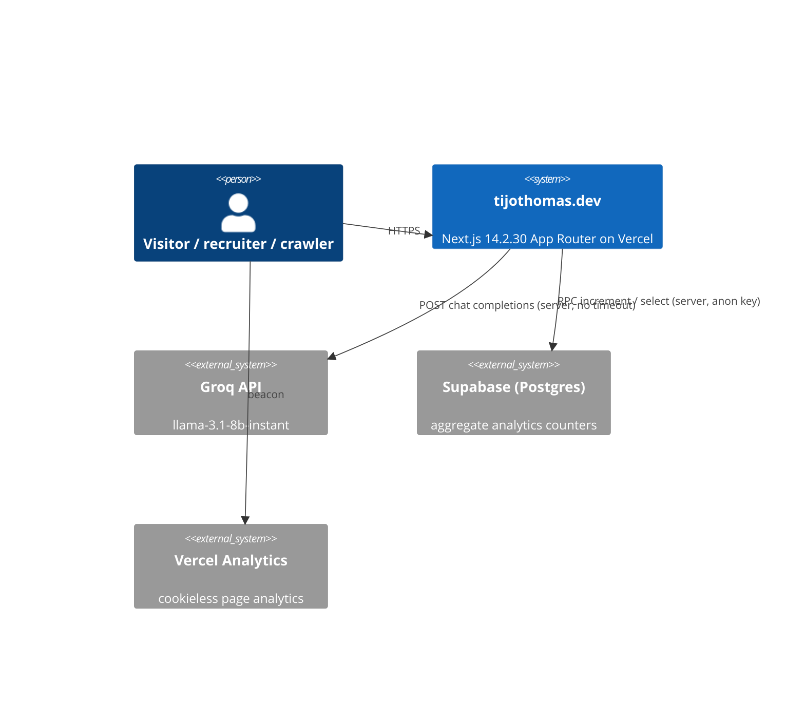
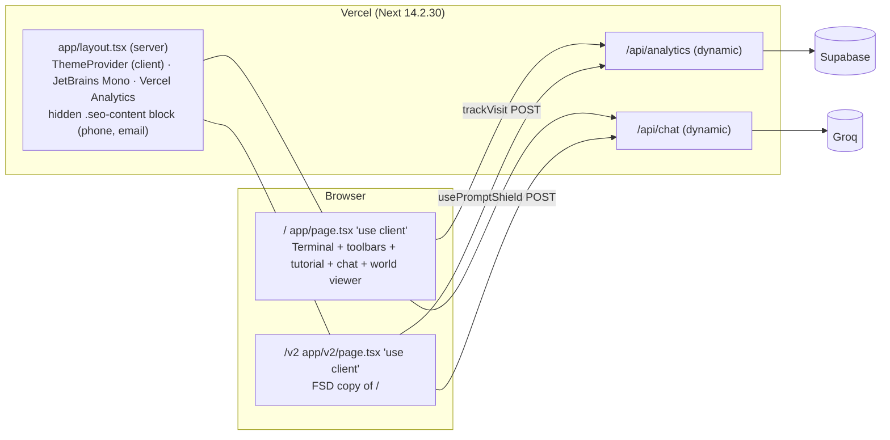
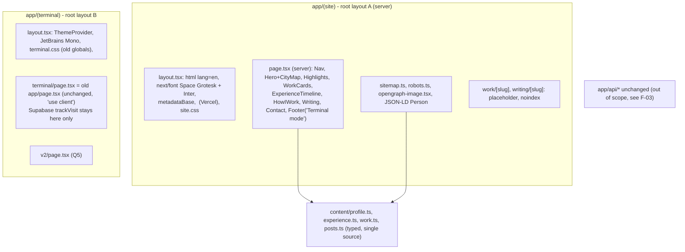

# Audit report: tijothomas.dev (EDD stage 1.0, brownfield)

- **Branch / commit:** `redesign-home` @ `193a733` (base `241ad16`)
- **Date:** 2026-11-23
- **Auditor:** edd-codebase-auditor (read-only; nothing outside `edd-docs/audit/` was modified)
- **Scope:** the whole repo, with depth on what the upcoming feature touches: the new server-rendered `/`, moving the terminal to `/terminal`, `content/*.ts`, SEO, analytics, and Lighthouse.
- **Labels:** **[F]** = fact, verified in code or by tool output (see `metrics.md` and `raw/`). **[I]** = inference, not verified.

## How the repo was sampled
- 260 tracked files. 185 non-test TS/TSX modules (about 22.6k LOC including tests and stories). [F] (`git ls-files`, `wc -l`)
- **Read in full:** `app/**` (layout, page, v2, both API routes), `next.config.js`, `vercel.json`, `tsconfig.json`, `tailwind.config.js`, `vitest.config.ts`, `vitest.setup.ts`, `.eslintrc.json`, `.env.example`, `.gitignore`, `.storybook/main.ts`, `lib/supabase.ts`, `lib/simple-analytics.ts`, `lib/version.ts`, `lib/utils.ts`, `shared/stores/sessionStore.ts`, `shared/api/http.ts`, `components/ThemeProvider.tsx`, `features/world-viewer/model/worldData.ts`, and the first 110 lines of `features/chat-assistant/model/useChatAssistant.ts`.
- **Grepped or sampled:** `components/Terminal.tsx` (data block L75-175, command switch), the chat UI (`ChatMessages.tsx`), `widgets/VersionSelector`, `app/globals.css`, and the design mockup `docs/design/home-reference/Main.dc.html` (structure, ids, text, colours). `support.js` and `vendor/` were ignored as instructed.
- **Full static analysis (scripted):** import graph, cycles, layer rules, and reachability over all 185 modules (`raw/cycles.txt`); ESLint complexity probe (`raw/complexity.txt`); `npm audit` (`raw/npm-audit.json`).
- **Not done:** Lighthouse. It needs a running server plus a heavy install, and the brief excludes dev servers that stay up. The baseline Lighthouse score is therefore **not measured**. See the roadmap item N-0.

---

## 1. Executive summary

### Ratings (A = exemplary, E = failing)
| Area | Rating | One-line reason |
|------|--------|-----------------|
| Architecture | **D** | Two parallel implementations (`components/` legacy and FSD `features/`/`widgets/`). 58 of 185 modules are unreachable from any route. The root route is client-only. Credit: 0 import cycles. |
| Code quality | **D** | Cyclomatic complexity up to 36 (`components/Terminal.tsx:199`). 5 files over 400 lines. 86 functions over 50 lines. Contact data duplicated in 9+ files. |
| Testing | **E** | 118 of 198 tests fail (12 of 16 files). `tsc` reports 139 errors, all in test files. No test covers a reachable critical path (`components/Terminal.tsx`, `app/page.tsx`, the API routes). No CI. |
| Security | **D** | `next@14.2.30` has critical and high advisories. Unauthenticated LLM proxy with a client-controlled system prompt and no rate limit or timeout. No security headers. A config-disclosure GET endpoint. |
| SEO / crawlability (feature-critical) | **E** | The server HTML for `/` is "Loading tijothomas.dev..." plus an off-screen hidden text block. No canonical, OG image, sitemap, robots or JSON-LD. |
| Accessibility | **D** | `maximum-scale=1` blocks pinch zoom. After hydration the page has two `h1`. No `prefers-reduced-motion` anywhere in product code. Credit: there is a skip link. |
| Performance | **C** | `/` is statically prerendered, with 136 kB first-load JS. But all visible content arrives only after hydration, so LCP is bound to JS. [I] |
| Resilience | **D** | Build crashes when the Supabase env vars are missing. The Groq call has no timeout. Credit: analytics fails soft, and `shared/api/http.ts` has a timeout and backoff. |
| Operability | **D** | No CI, no pre-commit hooks, no health or monitoring beyond Vercel defaults. README is untracked because `.gitignore` ignores `*.md`. |
| Data and compliance | **C** | Analytics are aggregate and cookieless (credit). But phone and email sit in hidden HTML and client bundles, the GET stats endpoint is public, and the RLS policies `WITH CHECK (true)` allow anonymous counter inflation. |
| Maintainability / DX | **D** | Dead code, duplicated components, an unused store (zustand) and an unused dependency (gsap). `edd-state.md` records the wrong Next version. |
| AI components (out of scope) | **D** | No evals. The client supplies the prompt context. No cost cap. These are for the later "Ask Tijo" feature. |

### Top 5 risks (by business impact)
1. **F-01 Crawlers and recruiters see almost nothing on `/`.** The only content is an off-screen hidden block, which also carries cloaking risk. This is the business problem the feature exists to solve.
2. **F-04 Factual integrity.** The repo holds unverifiable or NDA-sensitive metrics ("40%", "60%", "10k+", "1000+", "hours to minutes") and job titles that conflict with the mockup. If `content/*.ts` were seeded from repo data, the spec's hard content rules would be broken.
3. **F-05 The root layout and global CSS leak into every route.** This includes the ThemeProvider `<html>` class mutation, a hidden SEO `h1`, `maximum-scale=1`, terminal colours, and the mobile `html, body, main {height: 100vh}` rule. Left as is, the new `/` fails the 360px check and loses Lighthouse points.
4. **F-02 `next@14.2.30` has known critical and high advisories.** A full fix needs `>=15.5.29` or `16.4.6` (React 19). The spec says "ask first", so this is an owner decision.
5. **F-03 `/api/chat` is an open, unmetered LLM proxy.** The system prompt is assembled from client-supplied `portfolioContext`, so anyone can make "Tijo's assistant" say anything, and burn the Groq quota. It stays live after the move.

### Top 5 strengths
1. **0 import cycles** across 185 modules. No upward layer imports. Only 5 cross-feature imports. [F] `raw/cycles.txt`
2. **TypeScript `strict: true`** (`tsconfig.json:7`), the `@/*` alias, and `next/font` already in use (`app/layout.tsx:3-10`).
3. **Privacy-conscious analytics design.** Only aggregate daily counters are sent (`lib/simple-analytics.ts:58-71`), there are no cookies, there is a privacy notice widget, and `@vercel/analytics` is cookieless.
4. **`/` already prerenders as static (○)**, so it is CDN-cacheable. `compiler.removeConsole` is on in production (`next.config.js:13`), and the bundle analyzer is wired in.
5. **The mockup is accessible by construction.** Main text `#0f1b2d` on white is 17.3:1, secondary text `#4a5568` is 7.5:1, and the accent CTA `#ff7a33` with `#0f1b2d` is 6.65:1. The city buildings already have `<a aria-label>`, and the design has one `h1` with `h2`/`h3` hierarchy. [F] contrast computed in `metrics.md`

---

## 2. Current architecture

### 2.1 C4 context

### 2.2 Container / route view

### 2.3 Module map and dependency direction [F]
| Layer | Files | LOC | Notes |
|-------|-------|-----|-------|
| `app/` | 5 | 1,295 | `page.tsx` (484 LOC, client) and `v2/page.tsx` (442 LOC, near-duplicate) |
| `components/` (legacy) | 21 | 5,206 | `Terminal.tsx` 952, `InteractiveWorldViewer.tsx` 1,030 (dead), `EnhancedChatAgent.tsx` 614 (dead) |
| `features/` | 109 | 9,609 | chat-assistant, prompt-shield, terminal (used only by `/v2`), world-viewer |
| `widgets/` | 49 | 2,900 | Analytics, Breadcrumbs, CommandSuggestions, PrivacyPolicy, SoundControls, ThemeControls, VersionSelector, ZoomControls |
| `shared/` | 21 | 2,350 | ui atoms/molecules, `api/http.ts`, zod schemas (dead), zustand store (dead) |
| `lib/` | 6 | 927 | supabase, simple-analytics, sounds, tutorial-manager, utils (CV text), version |

- Direction: `app → widgets → features → shared/lib`, with `components/` as a parallel legacy tree. 0 upward imports. 5 cross-feature imports, all to `features/prompt-shield` (FSD says features must not import each other).
- `app/page.tsx` mixes the legacy and FSD trees. It imports `components/Terminal`, `components/{Zoom,Sound,Theme}Controls`, `features/chat-assistant`, `features/world-viewer`, and 5 widgets. It reaches 88 modules (`raw/cycles.txt`).
- **Dead code:** 58 of 185 modules are unreachable from any route. Examples: the whole `components/{EnhancedChatAgent,FloatingAIAssistant,InteractiveWorldViewer,WorldViewer,...}`, `features/terminal/index-old.tsx`, the "Atomic*" chat variants, `shared/stores/sessionStore.ts`, and `shared/schemas/*`.

### 2.4 Data and stores
- **Supabase** has tables `daily_visits` and `usage_stats` (used by `app/api/analytics/route.ts`). The schema string in `lib/supabase.ts:282-331` describes *different* tables (`analytics_events`, `user_sessions`) that no route uses. The schema has drifted from the code, and there are no migrations in the repo.
- **localStorage keys:** `tijothomas-theme` (`components/ThemeProvider.tsx:56,63`), `tijothomas-zoom` (`components/ZoomControls.tsx:42,56`; `widgets/ZoomControls/index.tsx:41,54`), `tijothomas-sounds` (`lib/sounds.ts:9,134`), `portfolio-analytics` (`lib/simple-analytics.ts:10`), and `tijothomas-session` (zustand persist, `shared/stores/sessionStore.ts:104`; the store is never imported, so this key is never written).
- **Profile facts** live as hard-coded copies in at least 9 files (see section 3.2 and `reconstructed-adrs.md` ADR-R12).

### 2.5 Deployment
- Vercel. `vercel.json` contains only `{"framework":"nextjs"}`. No `headers()`, no middleware, no CI workflows (`.github/` is absent), and no Husky.
- Build: `next build` succeeds **only** when `NEXT_PUBLIC_SUPABASE_URL` is set. [F] `raw/build.txt` vs `raw/build2.txt`

### 2.6 What a crawler sees on `/` today [F] (`.next/server/app/index.html`, 12,060 bytes)
- The visible body text is `Loading tijothomas.dev...` (`app/page.tsx:263-271`, `mounted` guard).
- Then the `.seo-content` block from `app/layout.tsx:88-120`. It is positioned at `left:-9999px` (`app/globals.css:156-162`) and contains an `h1`, skills, five jobs, **email and UK phone number**.
- Head: title, description, keywords, robots, OG and Twitter text tags. **No** `og:image`, **no** canonical, **no** JSON-LD, **no** `metadataBase`.
- After hydration the terminal renders a second `h1` ("tijothomas.dev", `app/page.tsx:305`), so two `h1`s are in the DOM.
- `/robots.txt` and `/sitemap.xml` do not exist (no `app/robots.ts` or `app/sitemap.ts`, and `public/` holds only `favicon.svg`).

---

## 3. Findings

Severity is judged by business impact for this feature: a recruiter-facing portfolio and SEO.

| ID | Area | Severity | Finding | Evidence | Standard violated | Impact | Fix | Effort |
|----|------|----------|---------|----------|-------------------|--------|-----|--------|
| F-01 | SEO / rendering | **critical** | `/` is a client component behind a `mounted` guard. The server HTML contains only "Loading..." plus an off-screen hidden text block. | `app/page.tsx:1,19,263-271`; `app/layout.tsx:88-120`; `app/globals.css:156-162`; built `index.html` | Google Search Essentials (hidden text); spec GOAL 1 | Recruiters and Google see nothing real. The hidden block risks being treated as cloaking. | New server-component `/`; delete the `.seo-content` block | M |
| F-04 | Content integrity | **high** | Unverified and NDA-sensitive metrics, plus conflicting titles, in repo data. Bet365 is "Senior Frontend Engineer" (`worldData.ts:6`, `layout.tsx:13`), "Software Engineer" (`Terminal.tsx:123`, `lib/utils.ts:58`), and "Software Developer" in the mockup. NetObjex is a COVID portal in the repo but "HIPAA-compliant hospitality" in the mockup. Opteamix is absent from the repo. | `features/world-viewer/model/worldData.ts:15,32,41,61,206,214,223,243,251`; `components/Terminal.tsx:103-112`; `features/chat-assistant/model/useChatAssistant.ts:77` | Spec CONTENT RULES (no invented metrics; bet365 NDA) | Publishing them is a reputational and NDA risk, and contradicts the CV. | Do not migrate repo data. Owner confirms the facts. `content/*.ts` is built from the confirmed list with `metric: null` → "Not yet measured". | S |
| F-05 | Architecture / CSS | **high** | The root layout and global CSS are terminal-specific and apply to every route: `ThemeProvider` rewrites `<html>` classes from localStorage; `html.dark`; body colours `var(--theme-bg)` (black and green); mobile `html,body{max-height:100vh}` and `main{height:100vh}`; `* {touch-action: manipulation}`; JetBrains Mono on `body`. | `app/layout.tsx:4,79-85`; `components/ThemeProvider.tsx:62-69`; `app/globals.css:108-109,167-181,217` | WCAG 2.2 1.4.10 Reflow; spec "360px no horizontal scroll" | A long scrolling `/` clips or overlaps on mobile, takes on terminal colours, and the fonts are wrong. | Split layouts (route groups) and move terminal CSS into the terminal segment | M |
| F-02 | Security / supply chain | **high** | `next@14.2.30` is affected by advisories, including critical image-optimizer RCEs (GHSA-2xp9-vwfh-vxw4, GHSA-2464-fhr4-w9xw) and high RSC DoS issues. The latest 14.x (14.2.35) fixes only some of them. A full fix is `15.5.29` (backport) or `16.4.6`. | `package-lock.json:7258-7260`; `raw/npm-audit.json` | CG10 (0 critical/high with fix); OWASP A06 | DoS or RCE classes exist. The image-optimizer exposure is likely low on Vercel and with no `next/image` usage [I]. | Owner decision Q1. At minimum bump to 14.2.35 and remove `images` config. | S–L |
| F-03 | Security (API) | **high** | `/api/chat` has no auth, rate limit, input cap or timeout. `portfolioContext` from the request body is interpolated into the system prompt. Errors echo `error.message`. `GET` discloses env presence and `NODE_ENV`. `RATE_LIMIT_REQUESTS_PER_MINUTE` is defined but never read. | `app/api/chat/route.ts:8,39-77,79-94,122,129,137-147`; `.env.example:29` | OWASP API4 (resource consumption), LLM01 (prompt injection), LLM10 (unbounded consumption), API8 | Groq cost and quota abuse; the assistant can be made to say anything under the owner's name. | Out of feature scope. Until "Ask Tijo" exists, rate-limit or disable it, build context server-side, add a timeout. | M |
| F-06 | Testing / gates | **high** | Baseline is red: `tsc --noEmit` reports 139 errors (all in 10 `*.test.tsx`); vitest has 118 of 198 tests failing (12 of 16 files). Tests target props or APIs the components don't have, and 4 failing files test unreachable modules. `next build`'s type step passes, but the `tsc` gate (CG3) fails. | `raw/typecheck.txt`; `raw/vitest.txt` | CG3, CG4 | CG3 and CG4 cannot pass on the full suite without a decision | Q4: fix, delete-dead, or scoped gate with a waiver | M |
| F-06b | Testing / config | **high** | `vitest.config.ts` has no `@/` alias, so 3 suites fail to load (`Failed to resolve import "@/lib/utils"`). Every new test that imports `@/content/*` or `@/widgets/*` will fail the same way. Also, `include` covers only `features|widgets|shared`, so tests in `app/` or `content/` would not run. | `vitest.config.ts:12-21`; `raw/vitest.txt` | CG4 | New spec tests silently excluded or broken | Add `resolve.alias` `@` → repo root; widen `include` to `app/**`, `content/**`, `components/**` | S |
| F-07 | Resilience / build | **medium** | `createClient('')` runs at module load. `next build` fails with "supabaseUrl is required" when env is absent (fresh clone, CI, preview without env). | `lib/supabase.ts:7-10`; `raw/build.txt` | 12-Factor III; CG1 | CG1 can't run in clean CI | Lazy client with a guard; or remove the import from routes not using it | S |
| F-08 | Build config | **medium** | Tailwind `content` scans only `pages/`, `components/`, `app/`, `src/`. Classes used only under `features/`, `widgets/` or `shared/` are not generated. | `tailwind.config.js:4-9` | (correctness) | New home sections placed in `widgets/` or `shared/` (per FSD) would ship unstyled | Add `features/`, `widgets/`, `shared/`, `content/` to the globs | S |
| F-09 | Accessibility | **medium** | Viewport `maximumScale: 1` blocks pinch zoom on all routes | `app/layout.tsx:67-71` | WCAG 2.2 1.4.4; Lighthouse `meta-viewport` audit | Lighthouse a11y penalty; fails AA | Remove `maximumScale` (the terminal layout can keep its own) | S |
| F-10 | Security headers | **medium** | No CSP, HSTS (Vercel may add it by default [I]), X-Content-Type-Options, Referrer-Policy, Permissions-Policy or frame-ancestors. `X-Powered-By` is on (default). | `next.config.js:6-20` (no `headers()`, no `poweredByHeader:false`); `vercel.json:1-3`; no `middleware.ts` | OWASP ASVS 14.4; Lighthouse Best Practices | Lower Best Practices score; clickjacking and MIME risks | `headers()` in `next.config.js`; a static CSP is feasible for a server-only `/` | S |
| F-11 | Privacy | **medium** | Phone number, WhatsApp and email are hard-coded in the hidden HTML and in client bundles (via chat and terminal). The mockup deliberately uses `[YOUR EMAIL]`. | `app/layout.tsx:116-117`; `features/chat-assistant/model/useChatAssistant.ts:31-34`; `components/Terminal.tsx:88,149-151` | Spec PII "public contact links only"; GDPR data minimisation | Scraping and spam; contradicts the intake statement | Q3. Single source in `content/profile.ts`. | S |
| F-12 | Security (XSS) | **medium** | Chat renders `message.text`, including the *user's own* text and LLM output, through `dangerouslySetInnerHTML` after a `**` regex replace, with no escaping | `features/chat-assistant/ui/ChatMessages.tsx:69-80`; `features/chat-assistant/ui/molecules/MessageBubble.tsx:53`; `components/EnhancedChatAgent.tsx:459` | OWASP A03 | Self-XSS. LLM-reflected injection is possible because the fallback echoes the message (`route.ts:25`). | Escape first, or render markdown with React nodes. Out of scope, but on `/terminal`. | S |
| F-13 | Routing | **medium** | The version selector on `/` navigates to `/v1`, which doesn't exist (404). `/v2` is an indexable "development" duplicate. | `widgets/VersionSelector/VersionSelector.tsx:28-30`; `lib/version.ts:17,25`; no `app/v1` | (correctness) | Broken nav. After the move, the "v1" option must point to `/terminal`. | Map v1 to `/terminal`; Q5 for `/v2` | S |
| F-14 | Analytics data | **medium** | `POST /api/analytics` accepts any `type` (unknown types return success). It has no rate limit, and the RLS insert policies use `WITH CHECK (true)`. `GET` publicly returns 30 days of stats. | `app/api/analytics/route.ts:4-47,58-89`; `lib/supabase.ts:322-330` | OWASP API4 | Counter inflation; public metrics | Spec removes Supabase from `/` only. Later: rate-limit or retire it. | S |
| F-15 | Operability / DX | **medium** | No CI and no pre-commit hooks. `.gitignore:90` ignores `*.md`, so the README is untracked (`README.md` was deleted in history; `git check-ignore` confirms). | `.gitignore:90`; no `.github/` | DORA; EDD CG pipeline | Gates are not enforced on PRs | Add a GH Actions workflow for gates; un-ignore README (EDD 3.1) | S |
| F-16 | Code quality | **medium** | 10 functions over complexity 10 (max 36 at `components/Terminal.tsx:199`, 27 at `useChatAssistant.ts:135` and `EnhancedChatAgent.tsx:131`). 5 files over 400 LOC. 86 functions over 50 lines. | `raw/complexity.txt` | CG7 | Hard to change the terminal safely | Leave the terminal unchanged (spec); enforce CG7 on new code only | — |
| F-17 | Maintainability | **low** | 58 dead modules, duplicated legacy and FSD components, an unused zustand store, unused `gsap` (only in dead `CircularTimeline.tsx`), and a schema string that has drifted from the code | `raw/cycles.txt`; `shared/stores/sessionStore.ts`; `lib/supabase.ts:282` | YAGNI; CG8 | Noise; 4 failing test files target dead code | Later purge | M |
| F-18 | Accessibility / motion | **low** | No `prefers-reduced-motion` in product code (only one story file). The terminal auto-starts a typing tutorial after 5–8 s of inactivity. | `git grep prefers-reduced-motion`; `app/page.tsx:194-229` | WCAG 2.2 2.2.2 / 2.3.3 | Spec requires it for the new micro-interactions | Add a reduced-motion media query to the new CSS | S |
| F-19 | Resilience | **low** | The Groq `fetch` has no timeout or AbortController. `shared/api/http.ts` has one (10 s) but the route doesn't use it. | `app/api/chat/route.ts:79-94`; `shared/api/http.ts:69-74` | CG11 | The function hangs until Vercel's limit | Out of scope | S |
| F-20 | Docs / state | **low** | `edd-state.md` says `next ^16.2.2`. The actual spec in `package.json` is `^14.0.0`, installed `14.2.30`. The spec's path `docs/design/home-reference.html` is actually `docs/design/home-reference/Main.dc.html`. | `package.json` `"next": "^14.0.0"`; `node_modules/next/package.json` 14.2.30 | CG14 | Wrong planning assumptions (e.g. "`next lint` removed" is not true here) | Orchestrator corrects `edd-state.md` | S |
| F-21 | Supply chain (dev) | **low** | 30 npm-audit findings (7 critical, 18 high), mostly dev tooling: storybook 9.1.5, vitest 3.2.4, @vitest/browser, playwright < 1.55.1 | `raw/npm-audit.json` | CG10 | Only dev machines are exposed (the Storybook and Vitest UI servers) | Patch-level bumps (`@vitest/*@3.2.7`, storybook ≥ 9.1.21) | S |
| F-22 | Config | **low** | `images.domains` (deprecated) enables the optimizer for unsplash, but there is no `next/image` usage anywhere | `next.config.js:16-19`; `git grep next/image` returns nothing | Least functionality | Unneeded attack surface (see F-02) | Remove | S |

### 3.1 Notes on `next lint` and the Next version
- `next lint` **exists and works** in the installed Next 14.2.30. `npm run lint` exits 0 with 4 warnings (`raw/lint.txt`). It was removed in Next 16, so it only becomes a concern if Q1 picks 16.x. Then `lint` must become `eslint .` with a flat config. [F] for 14.x; the Next 16 removal is from the Next 16 release notes. [I, not verified in this repo]
- React is 18.3.1. Next 15 and 16 require React 19, so any upgrade beyond 14.2.x is an L-effort change that also touches the terminal, which the spec requires to stay "unchanged".

### 3.2 Factual data sources (locations only; no facts were invented)
| Source | Location | What it holds | Consistency |
|--------|----------|---------------|-------------|
| Design mockup (newest; dated "© 2026") | `docs/design/home-reference/Main.dc.html` (text extracted in `metrics.md` §6) | Headline, location (Bengaluru), relocation, Opteamix (Apr 2026–present), bet365 "Software Developer" Feb 2023–Nov 2025 with KYC/payments bullets, Infosys "Consultant / UI Lead", NetObjex, QBurst, Speridian, 3 work cards with `[TO MEASURE]` metrics, 3 posts "Coming soon", 5 How-I-work steps, highlights ("9+ years", "4 regulated markets", "10 languages") | Conflicts with all repo sources below |
| Spec | `docs/design/REDESIGN_SPEC.md:106-108` | "Lead Software Engineer (React, TypeScript, Go), ex-bet365 UK"; target roles; visa need | Matches mockup |
| Terminal data | `components/Terminal.tsx:75-175` | about, skills, projects (with 40%/60%/10k+/1000+ metrics), experience with MM/YYYY dates, contact, education | Matches `lib/utils.ts` |
| CV text generator | `lib/utils.ts:32-86` | Plain-text "resume" (not PDF): titles, dates, bullets, education | Bet365 = "Software Engineer" |
| World viewer | `features/world-viewer/model/worldData.ts:2-270` | timeline, skills with % "levels", projects, clients, all with metrics | Bet365 = "Senior Frontend Engineer" |
| Chat context | `features/chat-assistant/model/useChatAssistant.ts:26-90`; duplicate in `components/EnhancedChatAgent.tsx:~30-90` | name, role, contact, skills, companies, clients, achievements, education | Includes "40%" |
| Layout SEO block | `app/layout.tsx:12-63, 88-120` | meta description, keywords, jobs, contact | Bet365 = "Software Engineer" |
| Contact links | LinkedIn `linkedin.com/in/tijo-j-thomaz93` (e.g. `components/Terminal.tsx:151`); GitHub `github.com/tijo-thomaz` (`components/Terminal.tsx:298`); email and phone (see F-11); Twitter `@tijothomas` (`app/layout.tsx:62`, unverified handle) | — | — |
| CV PDF | **none.** `public/` contains only `favicon.svg` | The mockup's "Download CV (PDF)" has no asset | — |

**There is no `content/` directory and no typed profile module.** The closest reusable shape is `timelineData` in `worldData.ts`, but its values must not be reused (F-04). Recommendation: create `content/*.ts` fresh from owner-confirmed facts, using the mockup as the draft.

---

## 4. Edge cases

| # | Input / condition | Where it breaks | What happens | Test that would catch it |
|---|-------------------|-----------------|--------------|--------------------------|
| E1 | Viewport 360 px, long page | `app/globals.css:172-181` (`html,body{max-height:100vh}`, `main{height:100vh}` at ≤768px) | New sections overflow a 100vh `main`, causing clipping or overlap with the footer | Playwright at 360×740: `document.documentElement.scrollWidth <= 360` and each section's bounding box is visible after scroll |
| E2 | Pinch zoom | `app/layout.tsx:70` | Zoom is blocked (WCAG 1.4.4) | Unit test on exported `viewport`: no `maximumScale`, or a value ≥ 5 |
| E3 | JS disabled / crawler | `app/page.tsx:263-271` | Only "Loading..." | Build-output test: read `.next/server/app/index.html` and assert every section heading and body text from `content/*.ts` is present (the spec's view-source gate) |
| E4 | Heading outline | `app/layout.tsx:89` + `app/page.tsx:305` | Two `h1` after hydration | RTL test: `getAllByRole('heading',{level:1}).length === 1` on the new page; assert layout has no `h1` |
| E5 | Returning visitor with `tijothomas-theme=cyber` in localStorage | `components/ThemeProvider.tsx:55-69` | On any route under the root layout, `<html>` gets `theme-cyber`, and body colours come from the theme vars | Test: set localStorage, render the new layout, assert no `theme-*` class and the expected body background |
| E6 | Old bookmarks and backlinks to `/` expecting the terminal | route move | They land on the new home. Fine if the footer has "Terminal mode", but terminal-internal links still point to `/`. | E2E: from `/terminal`, the version selector and any "home" control navigate to an existing route (not `/v1`) |
| E7 | Version selector "v1" | `widgets/VersionSelector/VersionSelector.tsx:29`, `lib/version.ts:17` | 404 | Unit: `AVAILABLE_VERSIONS.every(v => existingRoutes.includes(v.route))` |
| E8 | Fresh clone or CI without `.env` | `lib/supabase.ts:7-10` | `next build` fails | CI job builds with an empty env |
| E9 | Tailwind class only in `widgets/home/*` | `tailwind.config.js:4-9` | Class missing from CSS | Build test: grep the built CSS for a sentinel class used only in the new widget dir |
| E10 | `metric: null` | new `content/work.ts` | Must render "Not yet measured", never a number | RTL (spec): no digit in the metric slot when `metric === null` |
| E11 | `SHOW_PLANNED` given as the env string `"false"` | new flag parsing | `"false"` is truthy, so planned items would show | Unit: the parser treats only `"true"` as true; planned cards are hidden by default in production |
| E12 | City building links | new `CityMap.tsx` | A link targets a missing id (mockup ids: `top`, `work`, `experience`, `writing`, `contact`) | Spec test: every `<a href="#x">` in CityMap has a matching `id` in the page |
| E13 | Anchor jump under a sticky nav | new Nav + sections | The heading hides under the header | CSS `scroll-margin-top`; Playwright: the heading's top is ≥ nav height after `#work` |
| E14 | Year and "Now" badge on a static page | `app/page.tsx:465` (`© 2025` hard-coded); new footer | The value is frozen at build time and goes stale until the next deploy | Derive from content (`end: null` → "Now"); footer year from build time is acceptable, with daily ISR or an explicit decision |
| E15 | Non-ASCII text ("·", "–", "→") in OG image | new `opengraph-image.tsx` | `next/og` default font may lack glyphs and show tofu boxes | Snapshot: render the OG route and assert 200 and `content-type: image/png`; visual check |
| E16 | `prefers-reduced-motion: reduce` | new CSS (car 12s, hover lift) | Animation still runs | Test that the CSS has a `@media (prefers-reduced-motion: reduce)` block disabling them; Playwright `emulateMedia` |
| E17 | Chat: 1 MB message or `portfolioContext: {}` | `app/api/chat/route.ts:8,53` | Unbounded input to Groq; `{}` throws TypeError and returns 500 with the message echoed | Route test: oversized body returns 413; malformed context returns 400 with a generic error |
| E18 | Groq hangs | `app/api/chat/route.ts:79` | No timeout; the function runs to Vercel's limit | Mock `fetch` never resolving; expect 504 within budget |
| E19 | Markdown injection in chat `****` | `features/chat-assistant/ui/ChatMessages.tsx:73` | HTML is injected (self-XSS) | RTL: rendering such a message creates no `img` element |
| E20 | Analytics: unknown `type`, replayed POSTs | `app/api/analytics/route.ts:11-47` | `success:true` with no-op; unlimited increments | Route test: unknown type returns 400; rate-limit test |
| E21 | Midnight boundary | `app/api/analytics/route.ts:9` (UTC date) | Visits are bucketed by UTC day, not the owner's local day | Document as accepted, or test with a fixed clock |
| E22 | "Download CV (PDF)" | mockup L16; `public/` | No PDF asset, so the link 404s or is a dead `#contact` | Build test: every `href` to `/…pdf` exists in `public/` (Q8) |
| E23 | Supabase outage | `lib/simple-analytics.ts:61-70` | Fails soft (credit). The route returns `success:false` with HTTP 200. | Keep: a test where a mock RPC error leaves the UI unaffected |

---

## 5. Target architecture (for this feature)

**What changes**
1. **Route groups with two root layouts** (recommended, Q9): `app/(site)` and `app/(terminal)`. This gives total isolation of `<html>` classes, fonts, viewport and CSS, so the terminal's global CSS can't reach `/`. The trade-off is a full page load when switching between `/` and `/terminal`, which is acceptable because they are different experiences. The alternative is a nested `app/terminal/layout.tsx` with a minimal root layout. It is simpler, but `ThemeProvider`'s `<html>` mutation and the client-nav CSS persistence need care.
2. **`/` as a server component.** No `"use client"` on the page. Client islands only if needed; the mockup's interactions are CSS-only.
3. **`content/*.ts`**: typed (`as const satisfies Profile`), the single source for both the page and the JSON-LD. Nullable `metric`. `status: 'live' | 'in-progress' | 'planned'`. `SHOW_PLANNED` is read from env with strict parsing.
4. **SEO**: `metadataBase`, per-route `metadata` (title under 60 characters, description, canonical, OG/Twitter), `app/sitemap.ts`, `app/robots.ts`, `opengraph-image.tsx` (`next/og`), JSON-LD `Person` on `/` and a `TechArticle` template for `writing/[slug]`.
5. **Hygiene the feature needs**: Tailwind `content` globs (F-08), a build that is independent of the Supabase env (F-07), security headers (F-10), no `maximumScale` (F-09), and no hidden SEO block (F-01).

**Patterns used**
- Strangler fig: `app/(site)` vs `app/(terminal)`. The new home grows beside the untouched terminal (spec: move, don't delete), so the trade-off is two layouts and duplicated `<Analytics/>`.
- Content as typed data (value objects): `content/*.ts`. This serves the "only facts in content/*.ts" rule, makes the "metric null" rule testable, and allows the JSON-LD to be generated. The trade-off is that the owner edits TS instead of a CMS.
- Feature flag: `SHOW_PLANNED`. The spec hides planned items in production. The trade-off is a flag-parsing edge case (E11).
- CDN + edge caching (static prerender): `/` serves the Lighthouse ≥ 95 NFR and crawlability. The trade-off is that content changes need a redeploy.
- Input validation at boundaries: deferred to "Ask Tijo" (F-03). It doesn't apply to a static page (YAGNI).

**What to keep:** Next App Router, TS strict, Tailwind 3.4, Vitest + Testing Library, Storybook (for the new atoms), `@vercel/analytics`, `next/font`, the FSD folder conventions (`widgets/home/*` for sections and `shared/ui` for atoms, once the Tailwind globs are fixed), and the whole terminal stack unchanged.

---

## 6. Roadmap, restricted to this feature

### Now (unit U-01, walking skeleton, 0–2 weeks)
| # | Item | Effort | Risk retired |
|---|------|--------|--------------|
| N-0 | Measure the **baseline Lighthouse (mobile)** of the current production `/` and save the result (case-study "before"). Add the Lighthouse CI and view-source gates to `gates.yml`. | S | Unmeasured NFR |
| N-1 | Owner answers Q1–Q9 (especially facts Q2 and Next version Q1) | S | F-02, F-04 |
| N-2 | Route split: create `app/(terminal)/terminal/page.tsx` containing the old `app/page.tsx` verbatim, plus `app/(terminal)/layout.tsx` (ThemeProvider, JetBrains, terminal CSS). Point VersionSelector "v1" to `/terminal`. Decide `/v2` (Q5). | M | F-05, F-13, E5–E7 |
| N-3 | New minimal site root layout: no hidden SEO block, no `maximumScale`, Space Grotesk + Inter via `next/font`, `<Analytics/>`. No Supabase import reachable from `/`. | S | F-01 (part), F-09, F-11 |
| N-4 | Build and test hygiene: vitest `@` alias and `include` globs (F-06b), lazy Supabase client (F-07), Tailwind globs (F-08), remove `images` config (F-22), and at minimum `next@14.2.35` if Q1 allows | S | CG1, F-02 (part) |
| N-5 | Gate baseline decision (Q4) recorded in `audit.md` (waiver with an owner and expiry, or a fix unit) | S | CG3, CG4 |

### Next (units U-02…, 1–3 weeks)
| # | Item | Effort | Risk retired |
|---|------|--------|--------------|
| X-1 | `content/profile.ts`, `experience.ts`, `work.ts`, `posts.ts` from confirmed facts, with type tests | S | F-04 |
| X-2 | Server sections + `CityMap.tsx` (server SVG, `<a aria-label>`), CSS micro-interactions with reduced-motion handling | M | F-01, F-18 |
| X-3 | Spec tests: one h1; building links resolve to ids; metric null → "Not yet measured"; planned hidden; view-source text | S | E3, E4, E10–E12 |
| X-4 | SEO: metadata, canonical, sitemap, robots, OG image, JSON-LD Person/TechArticle, `noindex` placeholders | S | F-01 |
| X-5 | Security headers in `next.config.js` (CSP, HSTS, nosniff, Referrer-Policy, Permissions-Policy, `frame-ancestors 'none'`), `poweredByHeader:false` | S | F-10 |
| X-6 | GitHub Actions running CG1–5, CG7, CG9, CG10 and Lighthouse CI on PRs; un-ignore `README.md` | S | F-15 |

### Out of scope, later
- Next 15.5.29 or 16.x plus a React 19 upgrade, if not chosen in Q1. With 16, replace `next lint` with `eslint .` (flat config). L.
- `/api/chat` hardening or retirement before "Ask Tijo": rate limit, timeout, server-side context, input cap, remove the GET env disclosure, fix the markdown XSS (F-03, F-12, F-19). M.
- Retire Supabase analytics entirely, or rate-limit it and make the GET private. Reconcile the schema string with the real tables (F-14). S.
- Purge the 58 dead modules and dedupe `components/` vs `features/`. Delete tests of dead code. Drop the `gsap` and `zustand` dependencies if unused (F-17). M.
- Dev-tooling CVE bumps: storybook, vitest, playwright (F-21). S.
- Refactor the terminal below CG7 thresholds, only if it ever stops being "unchanged" (F-16). L.

---

## 7. Open questions for the owner
See `README.md` § Open questions (Q1–Q9, multiple choice).
