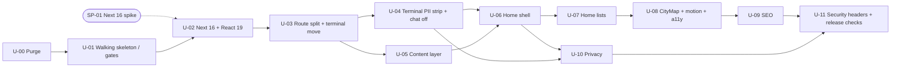

# Delivery plan: tijothomas.dev home redesign (EDD stage 1.5)

- **Date:** 2026-11-23 · **Branch:** `redesign-home`
- **Inputs:** `specs/*.md` (93 ACs, amended after PG3), `inception/prd.md`, `user-stories.md`, `threat-model.md`, `compliance.md`, `questions/*` (owner answers binding).
- **Shape:** 12 small units, one person, built in order. Each unit is a few small commits and ends with `npm run gates` green (from U-01 on). Every spec AC belongs to exactly one unit (§6).
- **Flags:** no `hot-path` units (`/` is a static CDN page; performance is proven by the Lighthouse gate, not CG12). No `ai` units (the only AI call is removed in U-04). `critical` = U-00, U-02, U-03, U-04, U-11.

## 1. Unit order

| # | Unit | Goal (one line) | ACs | Flags | Size |
|---|------|-----------------|-----|-------|------|
| U-00 | [Baseline purge](units/U-00-baseline-purge.md) | Delete dead and `/v2`-only code, Storybook and their tests; vitest config; green tests | 5 | critical | M |
| U-01 | [Walking skeleton: gates](units/U-01-walking-skeleton-gates.md) | `gates.yml` + runner, Oxlint, spec:check, gitleaks/SBOM, Playwright harness, baseline Lighthouse | 6 | **walking skeleton** | M |
| U-02 | [Next 16 upgrade](units/U-02-next16-upgrade.md) | Next 16.4.6 + React 19, lazy Supabase, build with empty env, CVEs closed | 5 | critical | M |
| U-03 | [Route split + terminal move](units/U-03-route-split-terminal-move.md) | `(site)`/`(terminal)` layouts, `git mv` into `terminal/`, `/v2` 308, `/terminal` noindex, hello-world `/` | 13 | critical | M |
| U-04 | [Terminal PII strip + chat off](units/U-04-terminal-pii-strip-chat-off.md) | Data-only PII commit, delete `/api/chat`, "chat unavailable", PII + Groq scan gates | 8 | critical | S |
| U-05 | [Content layer](units/U-05-content-layer.md) | Typed `content/*.ts` from resolved facts, `SHOW_PLANNED` parser | 5 | — | S |
| U-06 | [Home shell](units/U-06-home-shell.md) | Nav, Hero text, Highlights, Contact, Footer as server components | 10 | — | M |
| U-07 | [Home lists](units/U-07-home-lists.md) | Work, Experience, How I work, Writing; view-source gate enforced | 13 | — | M |
| U-08 | [CityMap, motion, a11y](units/U-08-citymap-motion-a11y.md) | SVG city nav, CSS-only motion, 360 px / keyboard / axe checks | 10 | — | M |
| U-09 | [SEO](units/U-09-seo.md) | Metadata, OG, sitemap, robots, JSON-LD, `/work` + `/writing` scaffolds; Lighthouse enforced | 10 | — | M |
| U-10 | [Privacy](units/U-10-privacy.md) | `/privacy` page, footer link, corrected terminal modal | 3 | — | S |
| U-11 | [Security headers](units/U-11-security-headers.md) | Two-tier static headers + site CSP; release checklist | 5 | critical | S |

No unit is L. The owner's suggested U-01 (upgrade + Oxlint + gates) was split into U-01 (gates, Oxlint) and U-02 (upgrade), and Storybook removal moved into U-00 because the vitest config fix (PLAT-AC-05) needs it gone. The owner's U-02 restructure was split into U-03 (mechanical move) and U-04 (PG3 terminal changes) so the move commit stays provably unchanged. Home sections were split into U-06/U-07/U-08, and `/privacy` became its own unit U-10.

### Dependency graph

Build order: U-00 → U-01 → U-02 → U-03 → U-04 → U-05 → U-06 → U-07 → U-08 → U-09 → U-10 → U-11.

### Spikes (run before the unit that needs them; record in `edd-state.md`)
| ID | Question | Timebox | Feeds |
|----|----------|---------|-------|
| SP-01 | On a throwaway branch: does `npm i next@16.4.6 react@19 react-dom@19` resolve without `--force`, does `next build` pass, and which terminal files fail under React 19? | 1 h | U-02 (R1) |
| SP-02 | Pinned Oxlint: are the react, nextjs, jsx-a11y, typescript, vitest plugins and `complexity`/`max-depth`/`max-params` rules available? Which old ESLint rules have no equivalent? | 30 min | U-01 (R10, RQ-21) |

## 2. Milestones and MVP cut line
| Milestone | After | What it proves |
|-----------|-------|----------------|
| M1 Green baseline | U-02 | Clean, upgraded, env-independent build; every gate runs from one command |
| M2 Safe split | U-04 | `/terminal` works at its new URL; no route serves owner email/phone; nothing talks to Groq |
| M3 New home (demo) | U-08 | Complete `/` server-rendered, accessible, CSS-only motion. Can be shown on a Vercel preview **after owner approval to push** |
| M4 Release candidate | U-11 | SEO, privacy notice, headers, all 93 ACs cited, all gates enforced |

**MVP cut line = after U-11.** Every unit above is Must (or a PG3 "Now" item). The production deploy needs U-00 to U-11 plus the owner checklist in U-11.

**Below the line (not in this feature):** SEC-40 to SEC-46 (chat context, chat XSS, `/api/analytics` hardening, Supabase var rename, CSP reporting, security.txt; SEC-45 is closed by SQ-03 a), "Ask Tijo", real MDX posts and case studies, CV PDF, Supabase retirement, CI workflow and Dependabot (stage 3.1), manual cross-browser pass NFR-060 (stage 3.2), legal review (SQ-08 a).

## 3. Risks and the unit that retires each
| ID | Risk | Retired by | How |
|----|------|-----------|-----|
| R1 | Next 16 / React 19 breaks terminal code | SP-01, **U-02** | spike first; codemods; smoke e2e + manual checklist |
| R2 | Facts not confirmed | (retired) U-05 | all 90 rows resolved; CONT-AC-10 gate |
| R3 | NDA exposure (bet365) | U-05 | facts-row refs + owner spot check |
| R4 | Lighthouse < 95 because of the SVG | U-08 (early read), U-09 (enforced) | report-only numbers read from U-06 on |
| R5 | CG10 fails on dev-tool CVEs | U-00, U-02 | Storybook removed; dev bumps (RQ-08 a) |
| R6 | Writing section empty in production | U-05, U-07 | `coming-soon` status (RQ-01 a); empty state |
| R7 | A "dead" module is loaded dynamically | **U-00** | graph re-run on the branch; deletion commit separate; manual smoke |
| R8 | OG image glyphs | U-09 | bundled local font |
| R9 | The big move hides a behaviour change | **U-03** | `git mv` commit then path-fix commit; PLAT-AC-10 |
| R10 | Oxlint misses old ESLint rules | SP-02, U-01 | rule-parity notes |
| R11 | `specs/` untracked | U-01 | PLAT-AC-18 gate |
| R12 | Disabling chat makes the terminal throw | U-04 | TERM-AC-08 (0 console errors) |
| R13 | PII strip changes more than data | U-04 | data-only commit reviewed on its own; rename-exception list |
| R14 | Site CSP breaks Next inline scripts or analytics | U-11 | PLAT-AC-22/24 + `/` static check |
| R15 | `/v2` returns 404 on the branch between U-00 and U-03 | U-03 | branch only, never deployed in between |
| R16 | spec:check cannot pass while later units' ACs are uncited | U-01 | `specs/pending.txt` staging list, emptied by U-11 (owner question Q-1) |

## 4. Traceability matrix (stories)
Primary unit = the unit that owns the story. Other units listed in brackets deliver some of its ACs.

| Story | Pri | FRs | Components | SEC / CMP | Spec ACs | Unit |
|-------|-----|-----|-----------|-----------|----------|------|
| US-01 | M | FR-060, FR-061 | `package.json`, `next.config.js` | SEC-13 | PLAT-AC-01, 02, 04 | U-02 |
| US-02 | M | FR-062–066 | `lib/supabase.ts`, `vitest.config.ts`, `tailwind.config.js`, `next.config.js` | SEC-17 | PLAT-AC-03, 07 [U-00: 05; U-03: 06; TERM-AC-06 in U-03] | U-02 |
| US-03 | M | FR-003–008 | `app/(terminal)/*`, `terminal/**`, `next.config.js` redirects | SEC-12 | TERM-AC-01–05, HOME-AC-04, 05 [HOME-AC-18 in U-06] | U-03 |
| US-04 | M | FR-001, 002, 007, 021, 030 | `app/(site)/{layout,page}.tsx`, `components/Hero.tsx` | — | HOME-AC-01, 03 [HOME-AC-02, 06 in U-07; 07 in U-08] | U-06 |
| US-05 | M | FR-022, FR-031 | `components/CityMap.tsx` | — | HOME-AC-08, 10 [HOME-AC-09 in U-07] | U-08 |
| US-06 | M | FR-023 | `components/Highlights.tsx` | — | HOME-AC-12 | U-06 |
| US-07 | M | FR-011, FR-024 | `components/WorkCard.tsx`, `content/work.ts` | — | HOME-AC-13, CONT-AC-01, 02 [CONT-AC-11 in U-05] | U-07 |
| US-08 | M | FR-012 | `lib/flags.ts`, `lib/visible.ts` | — | CONT-AC-03, 04, 06 [CONT-AC-05 in U-05] | U-07 |
| US-09 | M | FR-025 | `components/ExperienceTimeline.tsx` | — | HOME-AC-14 | U-07 |
| US-10 | M | FR-026 | `components/HowIWork.tsx` | — | HOME-AC-15 | U-07 |
| US-11 | M | FR-027 | `components/Writing.tsx` | — | HOME-AC-16 | U-07 |
| US-12 | M | FR-016, 028, 029 | `components/{Contact,Footer}.tsx` | SEC-23, CMP-02 | HOME-AC-17, 18, CONT-AC-08 [CONT-AC-09, 14 in U-04] | U-06 |
| US-13 | M | FR-010, 013–015 | `content/*.ts` | SEC-11 | CONT-AC-10, 13, 15 [CONT-AC-07, 12 in U-06] | U-05 |
| US-14 | M | FR-020, FR-032 | `components/{Nav,SkipLink}.tsx` | — | HOME-AC-11 | U-06 |
| US-15 | M | FR-040–044 | CityMap CSS | — | HOME-AC-19, 20, 21 | U-08 |
| US-16 | M | FR-050, 051, 057 | page `metadata`, `opengraph-image.tsx` | SEC-23 | SEO-AC-01, 02 [SEO-AC-03, TERM-AC-03 in U-03] | U-09 |
| US-17 | M | FR-052, 053 | `app/sitemap.ts`, `app/robots.ts` | — | SEO-AC-04, 05 | U-09 |
| US-18 | M | FR-054 | `lib/json-ld.ts` | SEC-09, SEC-10, SEC-23 | SEO-AC-06, 11, PLAT-AC-23 | U-09 |
| US-19 | M | FR-055, 056 | `app/(site)/{work,writing}/[slug]` | — | SEO-AC-07, 08 | U-09 |
| US-20 | M | FR-068; NFR-001–006, 010, 020, 022, 040 | `gates.yml`, `scripts/{lighthouse,view-source}.mjs` | — | SEO-AC-10 [SEO-AC-09 in U-07] | U-09 |
| US-21 | M | NFR-011–018 | whole page, `e2e/home-*.spec.ts` | — | HOME-AC-22–25 | U-08 |
| US-22 | S | FR-067 | `next.config.js` `headers()` | SEC-01–08 | PLAT-AC-20, 21, 22, 24, 26 | U-11 |
| US-23 | S | FR-069 | `edd-docs/construction/U-01/baseline-lighthouse/` | — | none (process evidence) | U-01 |
| US-24 | M | FR-070, 072, 073 | `terminal/**`, `scripts/check-{imports,renames}.mjs` | — | PLAT-AC-08, 09, 10 | U-03 |
| US-25 | M | FR-064, 071, 080 | deletions, `scripts/check-{unreachable,deps}.mjs` | SEC-16 | PLAT-AC-11, 12, 13 | U-00 |
| US-26 | M | FR-061, FR-075; NFR-050, 053, 056 | `.oxlintrc.json` | — | PLAT-AC-14, 15, 16 | U-01 |
| US-27 | M | FR-074 | `package.json`, `.storybook/` (deleted) | SEC-16 | PLAT-AC-17 [PLAT-AC-05 in U-00] | U-00 |
| US-28 | M | FR-076–079; NFR-055 | `scripts/spec-check.mjs`, `.gitignore` | — | PLAT-AC-18, 19 | U-01 |
| PG3 SQ-01 | M | FR-003 | `app/api/chat` (deleted), chat model | SEC-30–35 (met by removal), CMP-04 | TERM-AC-07–10 | U-04 |
| PG3 SQ-05 | M | FR-016 | terminal data files, `scripts/pii-scan.mjs` | SEC-23, CMP-05 | TERM-AC-11, CONT-AC-09, 14 | U-04 |
| PG3 SQ-02 | M | FR-029 | `app/(site)/privacy`, `content/privacy.ts`, terminal modal | CMP-03 | HOME-AC-27, 28, TERM-AC-12 | U-10 |
| PG3 SQ-07 | M | — | `.env.example` | SEC-18 | PLAT-AC-27 | U-04 |

### SEC requirements → unit (each in exactly one unit)
| SEC | Unit | Proof |
|-----|------|-------|
| SEC-01–07 | U-11 | PLAT-AC-20, 21, 22 |
| SEC-08 | U-11 | PLAT-AC-20, 21, 26 |
| SEC-09, SEC-10 | U-09 | SEO-AC-06, PLAT-AC-23 |
| SEC-11 | U-05 | CONT-AC-13 |
| SEC-12 | U-03 | TERM-AC-04 |
| SEC-13 | U-02 | PLAT-AC-01, 02 (+ README timeframes in U-11) |
| SEC-14, SEC-15 | U-01 | PLAT-AC-25 |
| SEC-16 | U-00 | PLAT-AC-11, 17 (PLAT-AC-07 in U-02) |
| SEC-17 | U-02 | PLAT-AC-03 (HOME-AC-04 in U-03) |
| SEC-18 | U-04 | PLAT-AC-27, TERM-AC-09 + owner console (U-11 checklist) |
| SEC-19, SEC-21, SEC-22 | U-11 | owner checklist (no AC; console settings) |
| SEC-20 | U-06 | HOME-AC-26 |
| SEC-23 | U-04 | CONT-AC-14 (CONT-AC-15 U-05, HOME-AC-17 U-06, SEO-AC-11 U-09) |
| SEC-30–35 | U-04 | met by deleting `/api/chat` (TERM-AC-07, 10) |
| SEC-40–44, 46 | deferred | below the MVP line |
| SEC-45 | n/a | closed by SQ-03 a (no preload) |

## 5. Definition of Done (every unit from U-01)
`npm run gates` green: CG1 build (empty env from U-02), CG2 Oxlint, CG3 `tsc`, CG4 tests ×3, CG5 coverage (diff ≥ 80% lines / 70% branches; `content/`, `lib/` ≥ 85%), CG7 complexity, CG9 import graph, CG10 audit + gitleaks + signatures, CG14 docs, `spec:check` (with `specs/pending.txt`), PII scan (from U-04), view-source (enforced from U-07), Lighthouse mobile ≥ 95 ×4 (enforced from U-09). The unit's ACs are removed from `specs/pending.txt`. Review clean. No push or PR without owner approval.

## 6. AC coverage (93 ACs, each in exactly one unit)
| AC | Unit | AC | Unit | AC | Unit |
|----|------|----|------|----|------|
| PLAT-AC-01 | U-02 | PLAT-AC-02 | U-02 | PLAT-AC-03 | U-02 |
| PLAT-AC-04 | U-02 | PLAT-AC-05 | U-00 | PLAT-AC-06 | U-03 |
| PLAT-AC-07 | U-02 | PLAT-AC-08 | U-03 | PLAT-AC-09 | U-03 |
| PLAT-AC-10 | U-03 | PLAT-AC-11 | U-00 | PLAT-AC-12 | U-00 |
| PLAT-AC-13 | U-00 | PLAT-AC-14 | U-01 | PLAT-AC-15 | U-01 |
| PLAT-AC-16 | U-01 | PLAT-AC-17 | U-00 | PLAT-AC-18 | U-01 |
| PLAT-AC-19 | U-01 | PLAT-AC-20 | U-11 | PLAT-AC-21 | U-11 |
| PLAT-AC-22 | U-11 | PLAT-AC-23 | U-09 | PLAT-AC-24 | U-11 |
| PLAT-AC-25 | U-01 | PLAT-AC-26 | U-11 | PLAT-AC-27 | U-04 |
| HOME-AC-01 | U-06 | HOME-AC-02 | U-07 | HOME-AC-03 | U-06 |
| HOME-AC-04 | U-03 | HOME-AC-05 | U-03 | HOME-AC-06 | U-07 |
| HOME-AC-07 | U-08 | HOME-AC-08 | U-08 | HOME-AC-09 | U-07 |
| HOME-AC-10 | U-08 | HOME-AC-11 | U-06 | HOME-AC-12 | U-06 |
| HOME-AC-13 | U-07 | HOME-AC-14 | U-07 | HOME-AC-15 | U-07 |
| HOME-AC-16 | U-07 | HOME-AC-17 | U-06 | HOME-AC-18 | U-06 |
| HOME-AC-19 | U-08 | HOME-AC-20 | U-08 | HOME-AC-21 | U-08 |
| HOME-AC-22 | U-08 | HOME-AC-23 | U-08 | HOME-AC-24 | U-08 |
| HOME-AC-25 | U-08 | HOME-AC-26 | U-06 | HOME-AC-27 | U-10 |
| HOME-AC-28 | U-10 | CONT-AC-01 | U-07 | CONT-AC-02 | U-07 |
| CONT-AC-03 | U-07 | CONT-AC-04 | U-07 | CONT-AC-05 | U-05 |
| CONT-AC-06 | U-07 | CONT-AC-07 | U-06 | CONT-AC-08 | U-06 |
| CONT-AC-09 | U-04 | CONT-AC-10 | U-05 | CONT-AC-11 | U-05 |
| CONT-AC-12 | U-06 | CONT-AC-13 | U-05 | CONT-AC-14 | U-04 |
| CONT-AC-15 | U-05 | SEO-AC-01 | U-09 | SEO-AC-02 | U-09 |
| SEO-AC-03 | U-03 | SEO-AC-04 | U-09 | SEO-AC-05 | U-09 |
| SEO-AC-06 | U-09 | SEO-AC-07 | U-09 | SEO-AC-08 | U-09 |
| SEO-AC-09 | U-07 | SEO-AC-10 | U-09 | SEO-AC-11 | U-09 |
| TERM-AC-01 | U-03 | TERM-AC-02 | U-03 | TERM-AC-03 | U-03 |
| TERM-AC-04 | U-03 | TERM-AC-05 | U-03 | TERM-AC-06 | U-03 |
| TERM-AC-07 | U-04 | TERM-AC-08 | U-04 | TERM-AC-09 | U-04 |
| TERM-AC-10 | U-04 | TERM-AC-11 | U-04 | TERM-AC-12 | U-10 |

Per unit: U-00 5 · U-01 6 · U-02 5 · U-03 13 · U-04 8 · U-05 5 · U-06 10 · U-07 13 · U-08 10 · U-09 10 · U-10 3 · U-11 5 = **93**. Uncovered: 0.

## 7. Traceability gaps found
1. **PRD and user stories still predate PG3:** FR-013 and §6 rule 4 list "email" as a placeholder, FR-028 and US-12 show email "if supplied", FR-016 covers `/` only, and PRD §3 says `/api/chat` "stays live, unchanged". The specs (canonical) are amended; the PRD/US text is not.
2. **The threat model still shows SQ-01/SQ-02/SQ-05 threats as "Open"**, and has no SEC ID for "chat disabled". SEC-30 to SEC-35 are traced as "met by removal".
3. **NFRs with no AC**, verified only by gates or by hand: NFR-005 (JS ≤ 150 KB), NFR-006 (0 external fonts), NFR-012 (contrast, partly covered by axe), NFR-018 (200% zoom, manual in U-08), NFR-051 (coverage, CG5), NFR-060/061 (browsers, runtime: stage 3.2).
4. **No AC for owner-console controls:** SEC-18 (Vercel env), SEC-19, SEC-21, SEC-22, CMP-07. They are handled by the U-11 owner checklist.
5. **CONT-AC-09 overlaps CONT-AC-14** (it is a subset). It is kept because ACs are never deleted.
6. **US-23 / FR-069** has no AC by design (process evidence). It is a U-01 task.
