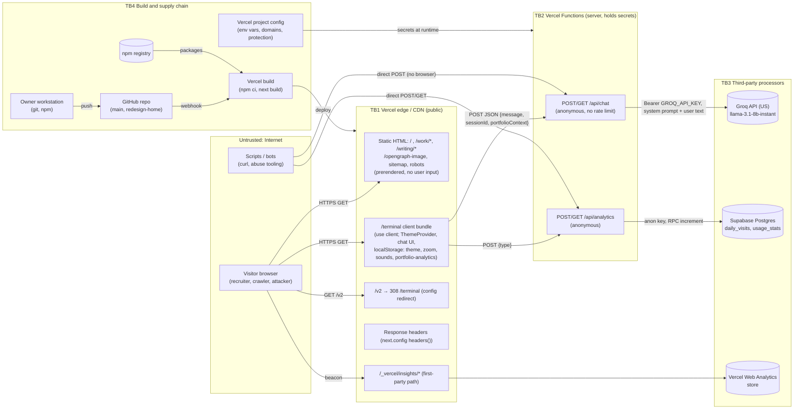

# Threat model: tijothomas.dev home redesign (EDD stage 1.3)

- **Branch:** `redesign-home` · **Date:** 2026-11-23 · **Author:** security architect (EDD 1.3)
- **Scope (this feature only):** static server-rendered `/` (plus `/work/[slug]`, `/writing/[slug]` placeholders, `/opengraph-image`, `/sitemap.xml`, `/robots.txt`); `/terminal` moved unchanged (noindex) and still calling `/api/chat` and `/api/analytics` (Q7a); `/v2` → `/terminal` 308; Next 16.4.6 + React 19; Oxlint; Vercel deploy.
- **Inputs:** `edd-state.md`, `questions/1.0-audit.md`, `questions/1.1-scope-change.md`, `questions/1.1-requirements.md`, `inception/prd.md`, `specs/*.md`, `audit/audit-report.md` (F-02, F-03, F-07, F-10, F-11, F-12, F-14, F-19, F-21, F-22), and code read for this stage: `app/api/chat/route.ts`, `app/api/analytics/route.ts`, `lib/supabase.ts`, `lib/simple-analytics.ts`, `next.config.js`, `vercel.json`, `.env.example`, `.gitignore`, `app/layout.tsx`, `features/chat-assistant/ui/ChatMessages.tsx`, `features/prompt-shield/model/usePromptShield.ts`, `widgets/PrivacyPolicy/molecules/PrivacyModal.tsx`.
- **No `inception/architecture.md` or `inception/adr/`** (stage 1.2 skipped for `feature`). Design changes are therefore filed below as **proposed ADRs** (§9) against the PRD and `audit/reconstructed-adrs.md`. Nothing in `specs/` or the PRD was edited.
- **Labels:** [F] verified in code or docs this stage; [I] inference to verify.

---

## 1. System and trust boundaries



| Boundary | Crosses from → to | What crosses | Notes |
|---|---|---|---|
| TB1 | Internet → Vercel edge | GET requests, Vercel Analytics beacons | `/` is static [F] (audit 2.6), no forms, no query parameters read. |
| TB1b | Internet → `/terminal` client | Client JS, localStorage, visitor-typed chat text | Same origin as `/`. No cookies or sessions exist anywhere on the origin [F]. |
| TB2 | Internet → Functions | Arbitrary JSON bodies to `/api/chat`, `/api/analytics` | Anonymous by design. Reachable by scripts, not only by the terminal UI. |
| TB3 | Functions → Groq / Supabase; edge → Vercel Analytics | Visitor chat text + client-supplied context (Groq); date counters only (Supabase); hashed request data (Vercel) | Groq and Vercel are US companies. Supabase receives no visitor identifiers [F] (`app/api/analytics/route.ts:13-38`). |
| TB4 | Owner / npm → GitHub → Vercel build → production | Source, lockfile, packages, env vars | No CI today (F-15); CI arrives in stage 3.1. |

---

## 2. Assets and classification

| ID | Asset | Classification | C / I / A | Where |
|---|---|---|---|---|
| A1 | Site availability and integrity of `/` (recruiter-facing reputation) | Public, **business-critical** | – / H / H | Vercel CDN |
| A2 | Content facts in `content/*.ts`, incl. bet365 rows limited by NDA | Public once confirmed; NDA-bound before | H (NDA) / H / – | repo, HTML, JSON-LD |
| A3 | `GROQ_API_KEY` | **Secret** | H / – / M (quota) | Vercel env (server) |
| A4 | `NEXT_PUBLIC_SUPABASE_URL` / `NEXT_PUBLIC_SUPABASE_ANON_KEY` | Internal (anon key is designed to be public, but RLS here is `WITH CHECK (true)`) | M / M / L | Vercel env; used only by `app/api/analytics` [F] |
| A5 | `SUPABASE_SERVICE_ROLE_KEY` | **Secret, critical** (bypasses RLS) | H / H / H | listed in `.env.example:22`, **unused in code** [F]; whether it is set in Vercel is unknown (SQ-07) |
| A6 | GitHub, Vercel, Groq, Supabase, registrar/DNS accounts | **Critical** (full takeover of site and domain) | H / H / H | SaaS consoles |
| A7 | Visitor request metadata: IP, User-Agent, referrer, geo | **Personal data** (transient) | M / – / – | Vercel edge logs, Vercel Analytics hash (discarded after 24 h, per Vercel docs [F]) |
| A8 | Visitor chat text on `/terminal` (free text; may contain names, emails) | **Personal data** (possible) | M / – / – | browser memory, `/api/chat`, Groq, possibly Vercel function logs (`route.ts:9` logs the message [F]) |
| A9 | Owner contact PII: personal email and UK phone/WhatsApp. **Owner decision (2026-11-23, reverses F-64): no email or phone anywhere on site routes; contact = LinkedIn + GitHub only** | Personal, owner-restricted | M / M / – | must be absent from `/` HTML, JS, metadata, JSON-LD, OG image; ~~still hard-coded in 7 modules `/terminal` reaches~~ **removed from `/terminal` by U-04** (`016d28c`, `b8c6890`; GitHub account corrected in `f030b11`, `7f0e31a`); enforced by CG10_pii_scan over every served file (§3 T-21) |
| A10 | Analytics counters (Supabase) | Internal, non-personal | L / L / L | Supabase |
| A11 | Groq quota and Vercel function budget | Financial / availability | – / – / M | provider accounts |
| A12 | Domain `tijothomas.dev` + TLS | Critical | – / H / H | registrar, Vercel DNS |

---

## 3. STRIDE by trust boundary

Likelihood (L) and impact (I): H / M / L. **Status:** `Planned` = covered by an existing or proposed AC in this feature; `By design` = the architecture removes the threat; `Owner` = console setting the owner must apply; `Deferred` = outside this feature (audit out-of-scope list), risk accepted until "Ask Tijo"; `Open` = waiting on a question in `questions/1.3-security.md`.

### TB1 Internet → site routes (`/`, placeholders, OG, sitemap, robots, `/v2`)
| ID | STRIDE | Threat | L | I | Mitigation (pattern) | Status |
|---|---|---|---|---|---|---|
| T-01 | Spoofing / Tampering | Clickjacking: `/` or `/terminal` framed inside an attacker page | M | L | CSP `frame-ancestors 'none'` on **every** response plus `X-Frame-Options: DENY` for old browsers (Gatekeeper at the edge) | Planned (PLAT-AC-20 + proposed PLAT-AC-21) |
| T-02 | Tampering | XSS on `/` | L | M | Static RSC render from build-time constants; no request input is read; React text escaping; one allowed raw-HTML sink (JSON-LD) with `<` → `<` (Output encoding); site CSP `object-src 'none'; base-uri 'none'`; Oxlint `react/no-danger` outside `lib/json-ld.ts` | Planned (SEO-AC-06, proposed PLAT-AC-23) |
| T-03 | Tampering / Info | TLS downgrade or SSL stripping on first visit | L | M | Vercel-managed TLS; `Strict-Transport-Security: max-age=63072000; includeSubDomains`; `upgrade-insecure-requests` | Planned; preload is SQ-03 |
| T-04 | Info disclosure | Stack fingerprinting: `X-Powered-By: Next.js`, browser source maps, `.git` | M | L | `poweredByHeader: false`; `productionBrowserSourceMaps` stays `false` (default); Vercel never serves `.git` | Planned (proposed PLAT-AC-26) |
| T-05 | Info disclosure | NDA-bound bet365 detail or unconfirmed facts published | L | H | Facts-row references in `content/*.ts` (CONT-AC-10); owner review of NDA rows | Planned |
| T-06 | Info disclosure | Owner email or phone leaks into a site route (Contact section, footer, metadata, JSON-LD, OG image, a client chunk, or a stray import of terminal data) → scraping, spam, contradicts owner decision | M | M | Owner decision: no email/phone on site routes. `content/profile.ts` has **no** `email`/`phone` field at all (type-level removal); HOME-AC-04 keeps `terminal/` data out of the `(site)` graph; build-output scan over every served HTML/JS/RSC/OG artefact of site routes for email and phone patterns → 0 (SEC-23) | Planned (proposed CONT-AC-14) |
| T-07 | Info disclosure | Referrer leaks to LinkedIn/GitHub | L | L | `Referrer-Policy: strict-origin-when-cross-origin`; URLs carry no secrets | Planned |
| T-08 | DoS | Traffic flood on `/` | L | M | Static prerender served from CDN; Vercel platform DDoS mitigation | By design |
| T-09 | Elevation | Compromised third-party script on `/` | L | M | No third-party script origins: Vercel Analytics v1 loads from the first-party path `/_vercel/insights/script.js` [F, Vercel docs]; CSP `script-src 'self'` (no external hosts) | Planned |
| T-10 | Spoofing | Open redirect via `/v2` | L | L | Fixed destination `/terminal` in `next.config` `redirects()`; no user-controlled target | By design (TERM-AC-04) |
| T-11 | Info / Spoofing | Preview deployments indexed or used as a second public copy (also exposing `/api/chat` with the production key) | M | M | Vercel Deployment Protection (Standard) on previews; `GROQ_API_KEY` scoped to Production only | Owner (SQ-06) |
| T-12 | Repudiation | — | – | – | No user actions on site routes; nothing to repudiate | n/a |

### TB1b Internet → `/terminal` client (moved unchanged)
| ID | STRIDE | Threat | L | I | Mitigation (pattern) | Status |
|---|---|---|---|---|---|---|
| T-20 | Tampering / Elevation | **Chat markdown XSS**: `ChatMessages.tsx:73` renders `message.text` through `dangerouslySetInnerHTML` after a `**` regex; the user's own text and the echoed fallback (`route.ts:25`, `usePromptShield.ts:213`) flow into it. Input `****` executes | L (self-XSS; no URL or shared-state vector found [I]) | L (origin has no cookies, sessions or secrets; impact = DOM defacement in the attacker's own tab) | Escape before the regex, or render `**bold**` as React `<strong>` nodes (Output encoding). One-file fix | Deferred (F-12) — optional in SQ-01 |
| T-21 | Info disclosure | Owner **email, phone and WhatsApp** hard-coded in modules `/terminal` reaches [F]: `components/Terminal.tsx:88,149-150,158,164,170,364,369` (`contact`, `git log`, resume error output); `lib/utils.ts:39-40` (generated CV text); `components/ContactMessage.tsx:10,12,22,25,88` and `components/ContactActions.tsx:14,16,26,29` (chat contact buttons: `mailto:`, `wa.me`); `features/chat-assistant/model/useChatAssistant.ts:31-33,250,320` (also sent in `portfolioContext` to `/api/chat` and on to Groq, `route.ts:46`); `features/prompt-shield/model/usePromptShield.ts:213`; `widgets/PrivacyPolicy/molecules/PrivacyModal.tsx:59-62`. Served in public JS on the same domain, so the owner decision is only half met | H | M | Data-only strip during the move (SQ-05 a) or accept (SQ-05 b). Dead copies (`EnhancedChatAgent.tsx`, `components/PrivacyPolicy.tsx`, `shared/schemas/chat.ts`, `features/terminal/model/useTerminal.ts`, `app/layout.tsx` hidden block) disappear with the purge / new layout | **Mitigated (U-04, SQ-05 a):** strip in `016d28c` (not strictly data-only; see U-04 review), hidden SEO block in `src/terminal/layout.tsx` removed in `b8c6890`, CG10_pii_scan gate over `/terminal` output; RCA-01 fixed the GitHub account |
| T-22 | Tampering | Attacker-planted `localStorage['tijothomas-theme']` leaks terminal theme into `/` | L | L | Separate root layouts (Q9a); HOME-AC-05 | Planned |
| T-23 | Info (compliance) | The terminal privacy modal states "No IP Tracking" and "Data stays in your browser", but chat text goes to Groq (US) and Vercel processes IPs → misleading notice | H | M | Correct the text and link to a single privacy notice (SQ-02) | Open (SQ-02) |
| T-24 | Tampering (integrity) | Terminal and chat still publish facts that `/` contradicts (old titles, "Manchester", "Currently at Bet365", "40%") | H | M | Out of scope (terminal unchanged); `/terminal` is noindex. Flagged to owner | Deferred |

### TB2 Internet → Functions (`/api/chat`, `/api/analytics`)
| ID | STRIDE | Threat | L | I | Mitigation (pattern) | Status |
|---|---|---|---|---|---|---|
| T-30 | DoS / financial | **Unbounded LLM proxy** (LLM10): any script can POST to `/api/chat` without limit; each call is a Groq completion (`max_tokens: 400`) plus a function invocation | H | M | Edge rate limit (Vercel Firewall rule, e.g. 10 req/min/IP on `/api/chat`), Groq per-key spend/usage limit and alert, body and message caps, 10 s timeout | **Mitigated (U-04, SQ-01):** `/api/chat` and the Groq handler deleted (`f7fc3df`); TERM-AC-07 e2e (404) and CG10_groq gate |
| T-31 | Spoofing / Tampering | **Prompt injection via client-supplied `portfolioContext`** (LLM01): the system prompt is built from the request body (`route.ts:39-77`), so anyone can make "an AI assistant representing Tijo" say anything and screenshot it on the owner's domain | H | M (reputation) | Build context server-side from `content/*.ts`; ignore client context (Guardrail sandwich, later) | Deferred (F-03) — residual named in SQ-01 |
| T-32 | Info disclosure | `GET /api/chat` returns env presence and `NODE_ENV`; POST returns `debug: {hasGroqKey, hasSupabase}`; 500s echo `error.message` (`route.ts:122,129,137-147`) | H | L | Delete `GET`, drop `debug`, generic error body | **Mitigated (U-04):** the whole route was deleted (`f7fc3df`) |
| T-33 | DoS | No timeout on the Groq `fetch` (`route.ts:79`) → the function runs until Vercel's max duration | M | L | `AbortSignal.timeout(10_000)` → 504; `export const maxDuration = 15` | Open (SQ-01 b) |
| T-34 | DoS | No body or field size caps; a 1 MB message is forwarded to Groq | M | L | Reject `content-length` > 8 KB (413); `message` 1–1000 chars, `sessionId` ≤ 64 chars (400) | Open (SQ-01 b) |
| T-35 | Info (privacy) | Visitor chat text logged: `console.log('📝 Received message:', message)` (`route.ts:9`). Whether `compiler.removeConsole` strips server-bundle logs is unverified [I] | M | M | Remove message logging; log only status, latency and body length | Open (SQ-01 b); verify on preview |
| T-36 | Tampering | Analytics counter inflation: any `type`, no rate limit; RLS `WITH CHECK (true)` | M | L | Allow-list `type`, rate limit, private `GET` | Deferred (F-14) |
| T-37 | Info disclosure | `GET /api/analytics` publishes 30 days of counters | H | L | Make private or remove | Deferred (F-14) |
| T-38 | Spoofing (CSRF) | Cross-site browser calls to `/api/*` | L | L | No cookies or credentials exist, so there is nothing to ride; JSON bodies force a CORS preflight and no `Access-Control-Allow-Origin` is sent | By design |
| T-39 | Repudiation | No record of who abused the chat | M | L | Vercel request logs (IP, path, status) only; accepted for a portfolio | Accepted |

### TB3 Functions → Groq / Supabase / Vercel Analytics
| ID | STRIDE | Threat | L | I | Mitigation (pattern) | Status |
|---|---|---|---|---|---|---|
| T-40 | Info (privacy) | Visitor chat text sent to Groq (US): third-country transfer; Groq retention unknown | M | M | Disclose in the privacy notice; verify Groq DPA, transfer mechanism and retention (compliance.md §1.6) | Open (SQ-02, SQ-08) |
| T-41 | Tampering | **Improper output handling** (LLM05): LLM output goes into the same `dangerouslySetInnerHTML` sink as T-20; an attacker controls only their own session | L | L | Same fix as T-20 | Deferred |
| T-42 | Info / Spoofing | `GROQ_API_KEY` leaks (preview env, logs, screenshots) → quota theft | L | M | Vercel "Sensitive" env var; Production scope only; the key is never logged (true today [F]); rotate on suspicion and every 12 months (Secret manager) | Owner (SQ-06) |
| T-43 | Elevation | `SUPABASE_SERVICE_ROLE_KEY` provisioned but unused → a needless RLS-bypass credential | L | H | Do not provision it; delete and rotate if present (Least privilege) | Owner (SQ-07) |
| T-44 | Elevation | `NEXT_PUBLIC_` prefix on the Supabase vars: a future client import would inline them into JS | L | L | HOME-AC-04 keeps Supabase out of `(site)`; rename to server-only names when the terminal is next touched | Deferred |
| T-45 | Info | Vercel Analytics stores query parameters | L | L | Site routes read no query parameters; Vercel filters query parameters [F, Vercel docs] | By design |

### TB4 Build and supply chain, Vercel configuration
| ID | STRIDE | Threat | L | I | Mitigation (pattern) | Status |
|---|---|---|---|---|---|---|
| T-50 | Tampering / Elevation | Known-vulnerable framework: `next@14.2.30` critical image-optimizer and RSC advisories (F-02) | H | H | Upgrade to `next@16.4.6` + React 19 (Q1c); remove `images` config (F-22) | Planned (PLAT-AC-01, 02, 07) |
| T-51 | Tampering | Malicious or hijacked npm package (worm-style maintainer compromises, as seen across npm in 2025) | M | H | `npm ci` from the committed lockfile; exact pins for new deps (`oxlint`); review lockfile diffs; purge unused deps (PLAT-AC-13 shrinks the surface); `npm audit signatures` in the gate; Dependabot/Renovate with a 3-day minimum release age (3.1) | Planned (partly 3.1) |
| T-52 | Info disclosure | Secret committed to git | L | H | `.env*` ignored [F]; working tree scanned this stage: 0 hits for `gsk_`, JWT, `sk-` patterns [F]; **history not scanned**: run `gitleaks detect` over the full history (CG10) | Planned (NFR-042) |
| T-53 | Tampering | Production deploy from a compromised GitHub or Vercel account | L | H | Phishing-resistant MFA (passkey/TOTP) on GitHub, Vercel, Groq, Supabase and the registrar; branch protection on `main`; production deploys only from `main` | Owner |
| T-54 | Tampering | Dangling DNS / subdomain takeover | L | H | Audit DNS records against live Vercel projects once before release | Owner |
| T-55 | DoS (build) | Build crashes without Supabase env (F-07) | H | L | Lazy, guarded Supabase client | Planned (PLAT-AC-03) |
| T-56 | Tampering | `next/og` fetches a web font at build or run time (network dependency, glyph failure E15) | L | L | Bundle a local font file in `opengraph-image.tsx`; no runtime font fetch | Planned (R8; proposed SEO note) |
| T-57 | Tampering | Header config drift or regression on a later deploy | M | M | e2e header assertions on every route class (`/`, `/terminal`, `/api/*`) | Planned (PLAT-AC-20 + proposed PLAT-AC-21, 22) |
| T-58 | Info | Dev-tool CVEs (storybook, vitest, playwright) | M | L | Storybook removed; remaining bumps per RQ-08 | Planned |

---

## 4. OWASP Top 10 for LLM Applications (2025): `/terminal` chat only

Site routes contain no LLM. The table covers the moved, unchanged `/terminal` chat → `/api/chat` → Groq path.

| Risk | Applies? | Finding | Now / deferred |
|---|---|---|---|
| LLM01 Prompt injection | **Yes** | Direct injection through `message`, plus full system-prompt control through `portfolioContext` (T-31) | Deferred to "Ask Tijo" (server-side context). Residual accepted via SQ-01 |
| LLM02 Sensitive information disclosure | Medium | The client sends the owner's email and phone in `portfolioContext` (`useChatAssistant.ts:31-33`), the system prompt includes them (`route.ts:46`) and instructs "Include contact information when relevant", so the model will hand them out, against the owner's no-email/phone decision. Visitor text goes to Groq (T-40) | SQ-05 (a strips them at source); privacy notice (SQ-02) |
| LLM03 Supply chain | Low | Hosted model via Groq; no fine-tuning, no local weights | Accept |
| LLM04 Data and model poisoning | No | No training or RAG | n/a |
| LLM05 Improper output handling | **Yes** | Raw-HTML rendering of LLM output (T-41) | Deferred; optional fix in SQ-01 |
| LLM06 Excessive agency | No | No tools, no actions, no writes | n/a |
| LLM07 System prompt leakage | Low | The prompt contains no secrets; it is client-supplied anyway | n/a |
| LLM08 Vector and embedding weaknesses | No | No vector store | n/a |
| LLM09 Misinformation | **Yes** | Hallucinated or stale claims under the owner's name ("Senior Frontend Engineer from Manchester", "Currently at Bet365", "40%") that contradict `/` (T-24) | Deferred; owner aware |
| LLM10 Unbounded consumption | **Yes** | No auth, rate limit, size cap or timeout (T-30, T-33, T-34) | **SQ-01** |

---

## 5. Security requirements (OWASP ASVS 5.0.0)

### 5.1 Chosen level: **ASVS 5.0 Level 1 with named Level 2/3 items**
- **Why L1:** there are no accounts, sessions, cookies, payments, uploads or stored visitor data. `/` is a static, read-only page built from constants. ASVS L2 targets apps that handle sensitive data or transactions, and most of the L2 chapters (V6–V10 authentication, sessions, authorisation, tokens, OAuth) have nothing to apply to.
- **Why add L2/L3 items:** the browser-header controls (3.4.3–3.4.6) are L2 in 5.0 but cost one config block and are needed for Lighthouse Best Practices ≥ 95 (NFR-040). The `/api/chat` resource-abuse controls (2.4.1, 15.2.2, 16.5.1) are L2 and address the highest-likelihood threat (T-30). COOP (3.4.8) and version hiding (13.4.6) are L3 but are one-line headers.
- **Re-assess to L2** when "Ask Tijo" ships (LLM input on `/`) or if any account, form or stored visitor data is added.

### 5.2 Requirements
"Now" = in this feature's scope. "Deferred" = outside it (audit out-of-scope list), with the reason. **AC** = an existing spec AC or a proposed one (§7).

| ID | Requirement (concrete, testable) | ASVS 5.0 | Scope | Threats | Verified by |
|---|---|---|---|---|---|
| SEC-01 | Every response (all routes, `/api/*` included) sends `Strict-Transport-Security: max-age=63072000; includeSubDomains` (preload per SQ-03) | 3.4.1 (L1) | Now | T-03 | PLAT-AC-20, proposed PLAT-AC-21 |
| SEC-02 | Every response sends `X-Content-Type-Options: nosniff` | 3.4.4 (L2) | Now | T-02 | PLAT-AC-20/21 |
| SEC-03 | Every response sends `Referrer-Policy: strict-origin-when-cross-origin` | 3.4.5 (L2) | Now | T-07 | PLAT-AC-20/21 |
| SEC-04 | Every response sends a CSP containing `frame-ancestors 'none'`, plus `X-Frame-Options: DENY` | 3.4.6 (L2) | Now | T-01 | PLAT-AC-20/21 |
| SEC-05 | Site routes send the **site CSP** in §6.2 exactly (no external host in `script-src`, no `'unsafe-eval'` in production, `object-src 'none'`, `base-uri 'none'`). `/` stays static (no nonce) | 3.4.3 (L2; L3 per-response nonce/hash **not met**, see §6.3) | Now | T-02, T-09 | proposed PLAT-AC-22; PLAT-AC-20 "0 CSP violations" |
| SEC-06 | Every response sends `Cross-Origin-Opener-Policy: same-origin` | 3.4.8 (L3) | Now | T-01 | proposed PLAT-AC-21 |
| SEC-07 | Every response sends `Permissions-Policy: camera=(), microphone=(), geolocation=(), payment=(), usb=(), browsing-topics=()`. Only features Chrome recognises are listed, so the console stays free of "Unrecognized feature" errors that would cost Lighthouse Best Practices points | no direct 5.0 ID; least functionality (cf. 15.2.3) | Now | T-09 | PLAT-AC-20 |
| SEC-08 | `poweredByHeader: false`; no `x-powered-by` on any response; no `*.map` files under `.next/static` in a production build | 13.4.6 (L3), 13.4.2 (L2) | Now | T-04 | PLAT-AC-20; proposed PLAT-AC-26 |
| SEC-09 | JSON-LD is serialised by one helper (`lib/json-ld.ts`) that applies `JSON.stringify` then replaces `<` with `<`. Data comes only from `content/*.ts` | 1.2.3 (L1) | Now | T-02 | SEO-AC-06 |
| SEC-10 | No `dangerouslySetInnerHTML` in `app/(site)`, `components/`, `content/` or `lib/` except `lib/json-ld.ts`. Enforced by Oxlint `react/no-danger` with a single file override | 3.2.2 (L1), 1.2.1 (L1) | Now | T-02 | proposed PLAT-AC-23 |
| SEC-11 | Every URL in `content/*.ts` uses `https:` (or `mailto:` for email). External links carry `rel` containing `noopener` | 1.2.2 (L1) | Now | T-02 | proposed CONT-AC-13; HOME-AC-17 |
| SEC-12 | Redirects use fixed internal destinations only (`/v2` → `/terminal`) | 3.7.2 (L2) | Now | T-10 | TERM-AC-04 |
| SEC-13 | `next@16.4.6`; 0 critical/high advisories with a fix available. Remediation timeframes are written in README: critical 7 days, high 30 days, moderate at the next release | 15.1.1 (L1), 15.2.1 (L1) | Now | T-50, T-58 | PLAT-AC-01, PLAT-AC-02 |
| SEC-14 | A CycloneDX SBOM is produced from the lockfile at each release (`npm sbom --sbom-format cyclonedx --omit dev > sbom.cdx.json`) and stored with the gate evidence | 15.1.2 (L2) | Now (local gate); CI in 3.1 | T-51 | proposed PLAT-AC-25 |
| SEC-15 | `gitleaks detect` over the full git history and the working tree reports 0 findings; `npm audit signatures` passes | 13.3.1 (L2), 15.2.4 (L3) | Now | T-51, T-52 | NFR-042; proposed PLAT-AC-25 |
| SEC-16 | Production ships only required functionality: 58+ unreachable modules, `/v2` page, `images` config, Storybook and test harnesses removed | 15.2.3 (L2) | Now | T-50 | PLAT-AC-07, 11, 17 |
| SEC-17 | The build needs no secrets; the Supabase client is created lazily and only on the server; `(site)` imports nothing that reaches Supabase | 13.3.1 (L2) | Now | T-55, T-44 | PLAT-AC-03, HOME-AC-04 |
| SEC-18 | Vercel env: `GROQ_API_KEY` marked **Sensitive** and scoped to **Production** only; `SUPABASE_SERVICE_ROLE_KEY` **not** provisioned; unused `RATE_LIMIT_REQUESTS_PER_MINUTE` removed from `.env.example` or implemented | 13.3.1, 13.3.2, 13.2.2 (L2) | Now (owner console + `.env.example`) | T-42, T-43 | owner checklist screenshot in gate evidence |
| SEC-19 | Preview deployments use Vercel Deployment Protection (Standard) and are not indexable | 13.4.5 (L2) | Now (owner console) | T-11 | `curl -I <preview-url>` → 401/redirect to Vercel login |
| SEC-20 | `/` sets 0 cookies and writes 0 localStorage/sessionStorage keys; no personal data beyond owner-confirmed public contact | 14.3.3 (L2), 14.2.3 (L2) | Now | T-06 | NFR-043; proposed HOME-AC-26 |
| SEC-23 | **No owner email address or phone number in any served artefact of site routes.** `content/profile.ts` (and its type) has no `email`, `phone`, `whatsapp` field; Contact, footer, `metadata`, OG/Twitter tags, JSON-LD (`Person` has no `email`/`telephone`) and the OG image carry LinkedIn + GitHub only. A gate scans `.next/server/app/**/*.{html,rsc,body}`, `.next/static/**/*.js` reachable from site routes, and the rendered `/opengraph-image` source props, for `/[A-Z0-9._%+-]+@[A-Z0-9.-]+\.[A-Z]{2,}/i`, `mailto:`, `tel:`, `wa.me` and `/\+?\d[\d\s().-]{8,}\d/` (phone-like) → 0 matches outside an allow-list of non-contact numbers | 14.1.1 (L2), 14.2.6 (L3), 15.3.1 (L1) | Now | T-06 | proposed CONT-AC-14 (extends CONT-AC-09); HOME-AC-17 amended |
| SEC-21 | TLS: Vercel-managed certificates, TLS 1.2+ only; all outbound calls (Groq, Supabase) use `https://` | 12.1.1 (L1), 12.2.1 (L1), 12.3.1 (L2) | Now (platform) | T-03 | one-off SSL Labs grade ≥ A on the apex domain, saved as evidence |
| SEC-22 | Owner accounts (GitHub, Vercel, Groq, Supabase, registrar) use phisheable-resistant MFA (passkey or TOTP, not SMS) | outside ASVS app scope (account hygiene) | Now (owner) | T-53 | owner attestation |
| **Minimal `/api/chat` guard (only if SQ-01 = b)** | | | | | |
| SEC-30 | `GET /api/chat` is removed (405); the POST response has no `debug` field | 13.4.5 (L2), 13.4.6 (L3), 15.3.1 (L1) | Now if SQ-01 b, else Deferred | T-32 | proposed TERM-AC-07 |
| SEC-31 | Errors return `{ "error": "Service unavailable" }` with no `error.message` | 16.5.1 (L2) | same | T-32 | proposed TERM-AC-08 |
| SEC-32 | Reject `content-length` > 8192 (413); `message` must be a string of 1–1000 chars and `sessionId` a string ≤ 64 chars (400) | 2.2.1 (L1), 2.2.2 (L1) | same | T-34 | proposed TERM-AC-08 |
| SEC-33 | Groq call uses `AbortSignal.timeout(10_000)`; on timeout the route returns 504; `export const maxDuration = 15` | 15.2.2 (L2), 16.5.2 (L2) | same | T-33 | proposed TERM-AC-09 |
| SEC-34 | Vercel Firewall rate-limit rule on `/api/chat`: 10 requests / 60 s / IP → 429 (plan availability to verify); Groq key usage limit and alert set in the Groq console | 2.4.1 (L2), 15.1.3 (L2) | Now (owner console) for a or b | T-30 | rule screenshot; `for i in 1..15 curl` → 429 on preview |
| SEC-35 | No chat message content is written to logs; one line per request: status, latency in ms, body length | 16.2.5 (L2) | Now if SQ-01 b | T-35 | proposed TERM-AC-10; Vercel log check on preview |
| **Deferred (audit out-of-scope; before "Ask Tijo")** | | | | | |
| SEC-40 | Ignore client `portfolioContext`; build the system prompt server-side from `content/*.ts` | 2.2.2 (L1), 1.3.7 (L2) | Deferred | T-31 | — |
| SEC-41 | Chat renders markdown as React nodes or escapes HTML first (fix `ChatMessages.tsx:73`, `MessageBubble.tsx:53`) | 1.3.5 (L2), 3.2.2 (L1) | Deferred (optional now, SQ-01 b+) | T-20, T-41 | — |
| SEC-42 | `/api/analytics`: allow-list `type`, rate limit, make `GET` private or remove it; tighten RLS | 2.2.1 (L1), 2.4.1 (L2), 13.4.5 (L2) | Deferred (F-14) | T-36, T-37 | — |
| SEC-43 | Rename Supabase vars to server-only names (no `NEXT_PUBLIC_`) | 13.3.1 (L2) | Deferred | T-44 | — |
| SEC-44 | CSP violation reporting endpoint (`report-to`) | 3.4.7 (L3) | Deferred | T-57 | — |
| SEC-45 | HSTS preload list submission | 3.7.4 (L3) | Open (SQ-03) | T-03 | — |
| SEC-46 | `/.well-known/security.txt` (RFC 9116) with contact and expiry | no 5.0 ID (good practice) | Deferred (optional) | — | — |

---

## 6. Header set (concrete)

### 6.1 Baseline: all routes (`/:path*`, incl. `/terminal`, `/api/*`, 404)
```
Strict-Transport-Security: max-age=63072000; includeSubDomains
X-Content-Type-Options: nosniff
Referrer-Policy: strict-origin-when-cross-origin
Permissions-Policy: camera=(), microphone=(), geolocation=(), payment=(), usb=(), browsing-topics=()
X-Frame-Options: DENY
Cross-Origin-Opener-Policy: same-origin
Content-Security-Policy: frame-ancestors 'none'; object-src 'none'; base-uri 'none'
```
- The baseline CSP restricts **no** scripts, styles or connections, so `/terminal` (inline style attributes, `fetch('/api/chat')`, `/api/analytics`, clipboard, Web Audio) behaves exactly as before. This honours RQ-11 (a): no strict CSP on the terminal.
- Not listed: `clipboard-write` (the terminal calls `navigator.clipboard.writeText`; the default `self` is kept) and `interest-cohort` (Chrome logs it as an unrecognised feature).

### 6.2 Site CSP: `/`, `/work/:path*`, `/writing/:path*`, `/opengraph-image`, `/sitemap.xml`, `/robots.txt`
Production value (one line in the header; shown wrapped):
```
default-src 'self';
script-src 'self' 'unsafe-inline';
style-src 'self' 'unsafe-inline';
img-src 'self' data:;
font-src 'self';
connect-src 'self';
manifest-src 'self';
object-src 'none';
base-uri 'none';
form-action 'none';
frame-src 'none';
frame-ancestors 'none';
upgrade-insecure-requests
```
Development only (`NODE_ENV=development`): add `'unsafe-eval'` (React dev error overlays) and `https://va.vercel-scripts.com` to `script-src`, because `@vercel/analytics` loads its debug script from that host in dev [I: verify against the installed version].

How each moving part fits:
| Part | Needs | Covered by |
|---|---|---|
| Next App Router runtime chunks `/_next/static/*` | external script, same origin | `'self'` |
| RSC flight data: inline `<script>self.__next_f.push(...)</script>` that Next emits into prerendered HTML | inline script | `'unsafe-inline'` (see §6.3) |
| `@vercel/analytics` v1 (`^1.5.0` [F]) | script `/_vercel/insights/script.js`, beacon `/_vercel/insights/view` | `'self'` in `script-src` and `connect-src` [F, Vercel docs: first-party path] |
| `next/font` (Space Grotesk, Inter, self-hosted) | `/_next/static/media/*.woff2` + CSS | `font-src 'self'`, `style-src 'self'` |
| Inline `style` attributes (CityMap SVG, Next font fallbacks) | inline styles | `style-src 'unsafe-inline'` (style injection risk is low; no user input) |
| JSON-LD `<script type="application/ld+json">` | **nothing**: it is a data block, not executed, so `script-src` does not govern it; no nonce or hash needed | protection is serialisation (SEC-09), not CSP |
| `next/og` `/opengraph-image` | none in the browser (PNG response; rendered at build) | CSP is harmless on an image. Bundle the font locally (T-56) |
| Inline SVG CityMap, `#anchor` links, `mailto:` | none | — |

### 6.3 Why not nonce or hash for `/`
| Option | Effect | Decision |
|---|---|---|
| **Nonce via `proxy.ts`** (Next 16 name for middleware) | Next docs [F]: nonces require dynamic rendering; static optimisation, ISR and CDN caching are disabled; PPR is incompatible | **Rejected**: breaks FR-001 / NFR-004 (static `/`) and puts NFR-001 (Performance ≥ 95, TBT, LCP) at risk |
| **Hashes of inline scripts** | Flight-data scripts change every build; Next emits no hash list; `next.config` `headers()` is evaluated before the HTML exists, so it needs a two-phase build or a post-build `vercel.json` rewrite | **Rejected for now** (brittle). Revisit at ASVS L3 |
| **`experimental.sri`** | Adds `integrity` to external chunks only; inline flight scripts still need `'unsafe-inline'` | Optional; low value with `'unsafe-inline'` present |
| **Static `'self' 'unsafe-inline'`** (Next's documented "without nonces" policy) | Keeps `/` static and CDN-cached; still blocks third-party script hosts, plugins, `<base>` hijack, framing and form posts | **Chosen** (proposed ADR-P1) |

Residual risk of `'unsafe-inline'`: if an HTML injection sink existed on `/`, the CSP would not stop inline script. `/` has no such sink: no request input is read, all text is build-time constants rendered by React, and the only raw-HTML sink is the escaped JSON-LD (SEC-09, SEC-10). Accepted at L1.

### 6.4 Implementation shape (for the platform unit)
`next.config.(js|ts)`: `poweredByHeader: false` and an async `headers()` that returns **the baseline rule for `/:path*` first, then the site-CSP rule** for the site sources listed in §6.2. Next applies the later rule's value when two rules set the same key on one path, so site routes get the strict CSP and everything else keeps the baseline CSP. Assert both route classes in e2e (proposed PLAT-AC-21/22), because ordering mistakes fail silently.

---

## 7. Proposed spec AC additions (not applied; for owner approval at PG2)

| Proposed ID | Spec file | Criterion | Verify | Traces |
|---|---|---|---|---|
| PLAT-AC-21 | platform.md | Given `next start`, when `GET /terminal`, `GET /api/analytics` and `GET /does-not-exist` are read, then each has `strict-transport-security`, `x-content-type-options: nosniff`, `referrer-policy`, `permissions-policy`, `cross-origin-opener-policy: same-origin`, a CSP containing `frame-ancestors 'none'`, and no `x-powered-by`; and TERM-AC-01 still passes | e2e | SEC-01–08, FR-067, RQ-11 |
| PLAT-AC-22 | platform.md | Given `GET /` on a production build, when the CSP is parsed, then `script-src` has no host and no `'unsafe-eval'`, and `object-src 'none'`, `base-uri 'none'`, `form-action 'none'`, `frame-ancestors 'none'` are present; and the build route table still marks `/` static | e2e + gate | SEC-05, NFR-004 |
| PLAT-AC-23 | platform.md | Given Oxlint with `react/no-danger` as error, when it runs, then 0 errors outside `terminal/`, and the only allowed use is in `lib/json-ld.ts` | gate | SEC-10 |
| PLAT-AC-24 | platform.md | Given the Vercel Analytics beacon on `/` under the site CSP, when the page loads in Playwright, then a request to `/_vercel/insights/view` (or the v2 intake path) is sent and 0 `securitypolicyviolation` events fire (production build with analytics enabled) | e2e | SEC-05, US-22 |
| PLAT-AC-25 | platform.md | Given the release gate, when it runs, then `sbom.cdx.json` (CycloneDX) is produced, `gitleaks detect` over full history reports 0 findings, and `npm audit signatures` exits 0 | gate | SEC-14, SEC-15 |
| PLAT-AC-26 | platform.md | Given a production build, when `.next/static` is listed, then there are 0 `*.map` files | gate | SEC-08 |
| HOME-AC-26 | home.md | Given a fresh browser context, when `/` loads and the analytics beacon fires, then `document.cookie === ''`, the context has 0 cookies for the origin, and `localStorage.length === 0 && sessionStorage.length === 0` | e2e | SEC-20, NFR-043 |
| HOME-AC-27 (if SQ-02 a/b) | home.md | Given the footer, when rendered, then a "Privacy" link targets `/privacy`; `/privacy` is static and lists the controller contact, Vercel Analytics, the `/terminal` chat → Groq flow, Supabase counters, retention and how to exercise rights | unit + e2e | compliance.md §1 |
| CONT-AC-13 | content.md | Given every URL-typed field in `content/*.ts`, when validated, then each starts with `https://` or, for email only, `mailto:`; no `javascript:`/`data:` | unit | SEC-11 |
| CONT-AC-14 | content.md | Given a production build, when every HTML, RSC payload and JS chunk served for site routes (`/`, `/work/*`, `/writing/*`, `/opengraph-image`, `/sitemap.xml`, `/robots.txt`) is scanned, then there are 0 email addresses (`/[A-Z0-9._%+-]+@[A-Z0-9.-]+\.[A-Z]{2,}/i`), 0 `mailto:`, 0 `tel:`, 0 `wa.me` and 0 phone-like digit runs (`/\+?\d[\d\s().-]{8,}\d/`, allow-list for build hashes/dates); and `Profile` has no `email`/`phone`/`whatsapp` key (type test) | gate + unit | SEC-23, T-06; owner decision reversing F-64 |
| SEO-AC-11 | seo.md | Given the `Person` JSON-LD and exported `metadata`, when inspected, then neither has an `email`, `telephone` or `contactPoint` property and no string contains `@` other than `@context`/`@type` keys | unit | SEC-23 |
| HOME-AC-17 (amend) | home.md | Replace "The email and availability lines are absent when null" with "No email line exists; contact links are LinkedIn and GitHub only" | unit | owner decision |
| TERM-AC-07 (if SQ-01 b) | terminal-route.md | Given `GET /api/chat`, then 405; given a valid POST, then the JSON has no `debug` key | e2e | SEC-30 |
| TERM-AC-08 (if SQ-01 b) | terminal-route.md | Given a POST body > 8192 bytes, then 413; given `message` empty or > 1000 chars or a non-string `sessionId`, then 400; given an internal error, then the body is exactly `{"error":"Service unavailable"}` | unit (route handler) | SEC-31, SEC-32 |
| TERM-AC-09 (if SQ-01 b) | terminal-route.md | Given a mocked Groq `fetch` that never resolves, when the route is called, then it returns 504 within 11 s | unit | SEC-33 |
| TERM-AC-10 (if SQ-01 b) | terminal-route.md | Given a POST with message `"canary-123"`, when the route runs, then no `console.*` call receives a string containing `canary-123` | unit | SEC-35 |

---

## 8. Cross-cutting models

### 8.1 Authentication and authorisation
- **Application:** none. There are no accounts, sessions, cookies or tokens; every route is anonymous and public by design (Zero trust: no request is trusted, so nothing grants privilege).
- **Privileged surface is outside the app:** GitHub (code), Vercel (deploy, env, domains, firewall), Groq and Supabase consoles, registrar/DNS. Controls: MFA (SEC-22), least-privilege keys (SEC-18), branch protection, production deploys from `main` only.
- **`/api/chat` and `/api/analytics`** are anonymous by necessity (the browser calls them). Abuse control is rate limiting and caps, not authentication (SEC-32–34).

### 8.2 Secrets management (pattern: Secret manager)
| Secret | Store | Scope | Rotation | Note |
|---|---|---|---|---|
| `GROQ_API_KEY` | Vercel env, **Sensitive** | Production only | on suspicion; every 12 months | Groq has no OIDC / short-lived credential option [I], so the "short-lived credentials" pattern cannot be applied; compensate with scope + usage limit |
| `NEXT_PUBLIC_SUPABASE_URL`, `NEXT_PUBLIC_SUPABASE_ANON_KEY` | Vercel env | Production (+ Preview if previews are protected) | on suspicion | Used only server-side today [F] |
| `SUPABASE_SERVICE_ROLE_KEY` | **must not exist** | — | delete and rotate if found | unused [F] |
| `SHOW_PLANNED` | Vercel env | per env | n/a | not a secret |
- `.env*` is git-ignored [F]; `.env.example` holds placeholders only [F]. The build must succeed with no env (PLAT-AC-03), so no secret is needed at build time.

### 8.3 Encryption
- **In transit:** Vercel-terminated TLS with managed certificates; HSTS (SEC-01); `upgrade-insecure-requests` on site routes; outbound `https://` to Groq and Supabase (SEC-21).
- **At rest:** no application-level data at rest. Provider-managed encryption at Vercel (logs, analytics) and Supabase (counters). Visitor localStorage on `/terminal` is under the visitor's control. No application crypto, so no key management is needed.

### 8.4 Logging and audit
- **Site routes:** no application logging. Vercel request logs (IP, path, status, UA) with plan-dependent short retention [I: confirm plan] are the only record.
- **`/api/chat`:** today it logs the visitor's message (`route.ts:9`) and the full Groq error body. Target (SEC-35): one line per request with status, latency and body length; never message content, never the key.
- **Security events worth alerting on (owner, low effort):** Groq usage alert; Vercel spend notification; Vercel Firewall 429 count. No SIEM; ASVS V16 L2 inventory (16.1.1) is satisfied by this paragraph.

### 8.5 Supply-chain controls
| Control | Tool | When | Req |
|---|---|---|---|
| Lockfile-exact installs | `npm ci` (Vercel and gate) | every build | T-51 |
| Vulnerability scan | `npm audit --json` (0 critical/high with fix) | every gate run | SEC-13 |
| Registry signatures | `npm audit signatures` | every gate run | SEC-15 |
| SBOM | `npm sbom --sbom-format cyclonedx --omit dev` | each release | SEC-14 |
| Secret scan | `gitleaks detect` (full history) + `gitleaks protect --staged` pre-commit | gate + pre-commit | SEC-15 |
| Dependency updates | Dependabot or Renovate with a minimum release age of 3 days | stage 3.1 | T-51 |
| Surface reduction | purge unused deps (PLAT-AC-13), exact pin for `oxlint` | this feature | T-51 |
| Provenance (target) | SLSA build provenance via GitHub Actions | stage 3.1 target | T-53 |

---

## 9. Proposed ADR amendments (for owner approval; nothing rewritten)

| ID | Amends | Proposal | Blocking? |
|---|---|---|---|
| **ADR-P1** Two-tier static security headers | PRD FR-067, RQ-11 (a); audit ADR-R (none for headers) | Baseline header set on all routes (§6.1) plus a static site CSP with `script-src 'self' 'unsafe-inline'` on site routes (§6.2), both in `next.config` `headers()`; no `proxy.ts` nonce. Rationale §6.3. Consequence: `/` stays static; ASVS 3.4.3 met at L2 wording, L3 not met | **Yes, as a constraint**: choosing nonce-based CSP would break FR-001/NFR-004. SQ-04 confirms |
| **ADR-P2** Interim `/api/chat` guard | PRD §3 "Out of scope: `/api/chat` hardening" | Depends on SQ-01. Option b adds ≈ 40 lines in `app/api/chat/route.ts` only (SEC-30–35); the terminal UI is untouched, so TERM-AC-01 is unaffected | No (owner choice) |
| **ADR-P3** Single privacy notice at `/privacy` | PRD §3 in-scope list, FR-029 footer | Static server route with content from `content/` and a footer link; terminal modal text corrected to match and link to it | Recommended before production release (SQ-02) |
| **ADR-P5** No contact PII in the site data model | PRD FR-013, FR-016, FR-028, §6 rule 4 ("email" placeholder); facts F-64 | `Profile` type drops `email`; the placeholder list becomes notice period + Opteamix bullets; FR-016 widens to "no email or phone in any served artefact of site routes" (SEC-23) | **Yes for `/`** (content-model change before the content unit) |
| **ADR-P4** Environment and preview hygiene | `.env.example`, Vercel project config | Groq key Production-only and Sensitive; no service-role key; preview Deployment Protection; remove the unused `RATE_LIMIT_REQUESTS_PER_MINUTE` | No (owner console) |

---

## 10. Residual risks (after "Now" controls)

| ID | Residual risk | Level | Owner decision |
|---|---|---|---|
| RR-1 | `/api/chat` prompt injection and misinformation under the owner's name (T-31, LLM01/LLM09) | Medium (reputation) | Accept until "Ask Tijo" (SQ-01) |
| RR-2 | `/api/chat` quota abuse if SQ-01 = a or d and no firewall rule is available on the Vercel plan | Medium | SQ-01 |
| RR-3 | `'unsafe-inline'` in site `script-src` | Low (no injection sink) | ADR-P1 |
| RR-4 | Owner email/phone still served on `/terminal` (JS bundle, chat answers via Groq) if SQ-05 = b | Medium | SQ-05 |
| RR-5 | Chat self-XSS on `/terminal` | Low | Deferred |
| RR-6 | Inaccurate terminal privacy modal | Medium (compliance) | SQ-02 |
| RR-7 | Analytics counter inflation / public stats | Low | Deferred (F-14) |
| RR-8 | Unscanned git history for secrets until the gitleaks gate runs | Low–Medium | SEC-15 |
